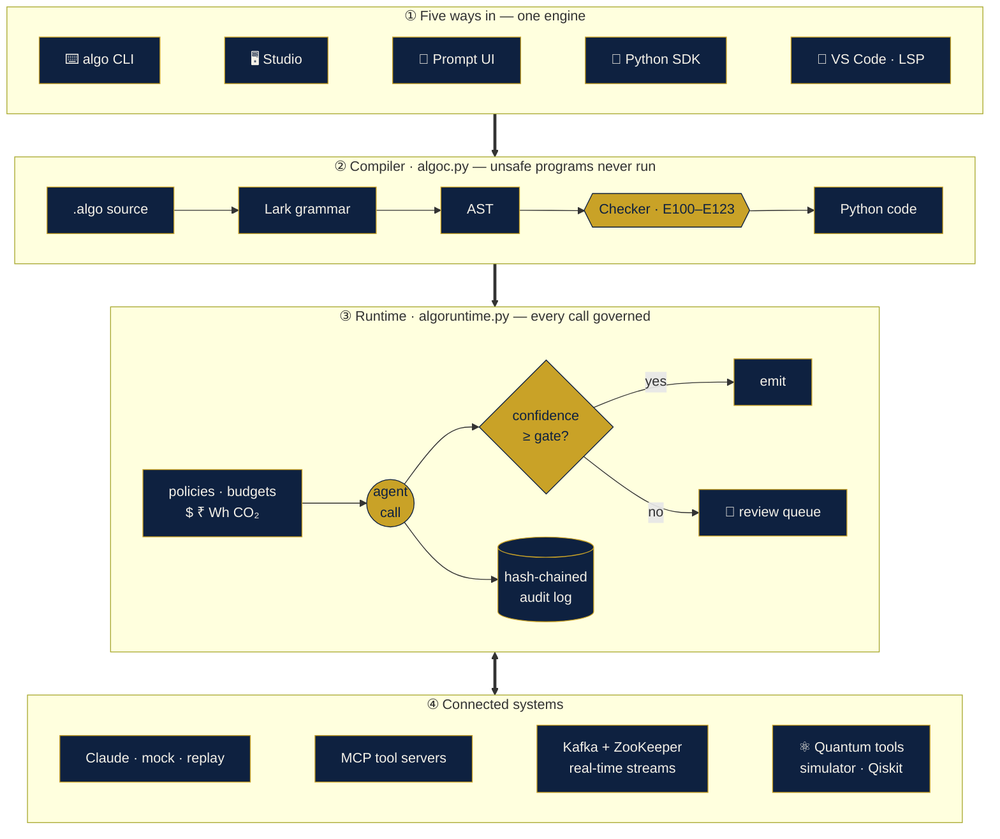
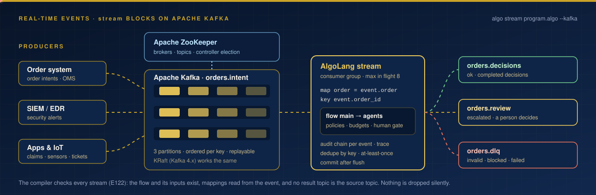
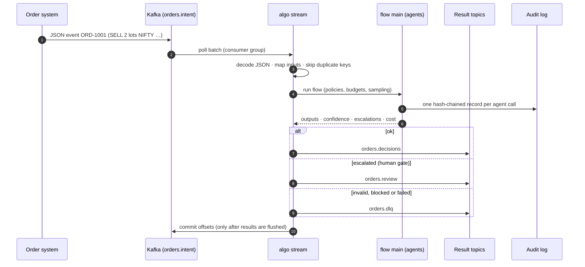
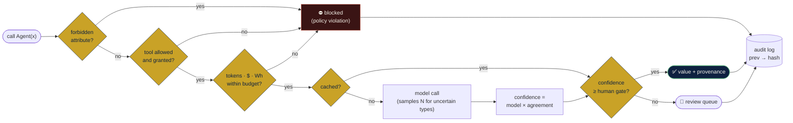

# AlgoLang — the agent-native programming language for trustworthy AI

[](https://github.com/drssnaiml1-cell/algolang/actions/workflows/ci.yml)
[](https://github.com/drssnaiml1-cell/algolang/releases/latest)
[](LICENSE)
[](https://www.algoprofessor.com)
[](https://www.profagentlabs.algoprofessor.com)
[](https://drssnaiml1-cell.github.io/algolang/)


<p align="center">
  <a href="https://www.algoprofessor.com"></a>
</p>

**The AlgoProfessor agent-native programming language.**
AlgoProfessor AI R&D Solutions, Hyderabad. Designed by Dr. S. Satyanarayana.
🌐 **[www.algoprofessor.com](https://www.algoprofessor.com)**

**Current version: 0.3.2** (quantum tools preview · real-time Kafka streams) · [Changelog](CHANGELOG.md) · [Roadmap](ROADMAP.md) · [50 Sample Programs (PDF)](docs/AlgoLang_50_Sample_Programs.pdf) · [Language manual (PDF)](docs/AlgoLang_Documentation_v0.3.pdf)

AlgoLang has **no functions**. Every unit of work is an `agent` with a role, a goal, explicit tools, a model and a policy. A `flow` is the only other construct, and it can do just four things:

- call agents
- run them in parallel
- branch on a score
- emit results

## AlgoLang at a glance



| | |
|---|---|
| **Write** agents and flows; the compiler rejects unsafe programs before anything runs (24 error codes). | **Govern** every call with budgets, forbidden attributes, allowed tools and a human gate. |
| **Prove** what happened: hash-chained audit logs, traces you can replay for free, `eval` blocks in CI. | **Scale** to real time: a `stream` block runs a flow for every event on a Kafka topic. |
| **Optimise** with quantum tools: every QAOA answer is VERIFIED against the exact optimum before an agent acts on it. | **Connect** to Claude, MCP tool servers, Kafka and quantum backends, from the CLI, Studio, SDK or your editor. |

## Contents

1. [Objective](#1-objective)
2. [Design principles](#2-design-principles)
3. [What's new in v0.3](#3-whats-new-in-v03)
4. [Get started](#4-get-started)
5. [Learn by example: 50 sample programs](#5-learn-by-example-50-sample-programs)
6. [Enterprise applications](#6-enterprise-applications)
7. [Real-time events: Kafka and ZooKeeper](#7-real-time-events-kafka-and-zookeeper)
8. [Quantum applications (preview)](#8-quantum-applications-preview)
9. [The language](#9-the-language)
10. [Governance and runtime guarantees](#10-governance-and-runtime-guarantees)
11. [Python SDK](#11-python-sdk)
12. [For developers](#12-for-developers)
13. [Roadmap: v0.4 Trustworthy AI, v0.5 Quantum AI](#13-roadmap-v04-trustworthy-ai-v05-quantum-ai)
14. [Repository layout](#14-repository-layout)
15. [ProfAlgoLabs™, author and licence](#15-profalgolabs-author-and-licence)

## 1. Objective

### Main objective

**To make AI systems built from agents safe, governed, auditable and trustworthy.** AlgoLang does this by giving them a language of their own, in which the only unit of work is an agent, the only way to combine agents is a flow, and the rules that keep people safe are part of the program text. The compiler and runtime enforce them.

### Basic objectives

| No. | Objective | What it means in the language |
|---|---|---|
| 1 | Agent-native design | There are no functions. Every task is an agent with a role, a goal, declared tools, a model and a policy. |
| 2 | Small, readable control flow | A flow can only call agents, run them in parallel, branch, and emit results. Anyone can read what happens and in what order. |
| 3 | Safety before running | The compiler finds the mistakes: calling a non-agent, using an undeclared tool, passing a forbidden attribute, or comparing an uncertain value without its confidence. |
| 4 | Governance built in | Token, cost and energy budgets, retries, forbidden attributes and human review are part of the program; an organisation file adds stricter rules for every program. |
| 5 | Accountability | Every agent call returns a value with its confidence and provenance, and is written to a hash-chained audit log that can be verified. Traces can be replayed. |
| 6 | Honest uncertainty | `uncertain<T>` agents are sampled several times. Their confidence reflects how much the samples agree, and decisions must check it. |
| 7 | Cost, speed and sustainability | Cheap models for easy steps, strong models where needed, caching, parallelism, and every call priced in money, watt-hours and CO₂. |
| 8 | Reuse at scale | 120 domain packs in 20 sectors, modules, MCP tools, Kafka streams, quantum tools, ten enterprise applications, and batch processing of thousands of records. |
| 9 | Access for everyone | Command line, graphical Studio, a plain-English Prompt UI, a Python SDK and editor support through a language server. |
| 10 | Teachable and testable | An offline backend runs without an API key. `eval` blocks and behaviour tests run in CI; live mode uses real Claude models. |

## 2. Design principles

- **Explicit, never ambient.** An agent has only the tools it declares. Nothing is available by default.
- **The stricter rule wins.** When the organisation policy and a program's own policy differ, the stricter one applies.
- **Hard rules are deterministic.** Limits that must never be broken are checked in code (`if limits contains "BREACH"`), not left to a model's judgement.
- **Scores drive decisions, and their confidence is shown.** Every branch has a visible reason that can be recorded.
- **People stay in the loop.** A low-confidence call goes to a human review queue instead of going out.
- **One engine, many doors.** The command line, Studio, Prompt UI, SDK and language server all run the same compiler and runtime.

## 3. What's new in v0.3

```algo
tool kb.search_policies from mcp "company-kb"        // 1. tools from any MCP server

agent Compliance(claim: text, rules: text) -> uncertain<score> {   // 2. uncertainty in the type system
    goal   "Score how well {claim} complies with {rules}"
    policy { samples 5  budget cost 0.05 usd  budget energy 2 wh }  // 3. money and energy budgets
}

flow main(claim: text) {
    rules = PolicyFinder(claim)
    ok    = Compliance(claim, rules)
    if ok > 0.6 and ok.confidence >= 0.7 { emit Approve(claim) }   // E117 without the confidence check
    else { emit Query(claim, rules) }
}

eval regression on main {                                    // 4. tests next to the code, replayable
    case "hotel within policy" (claim = "Hotel, 2 nights at INR 7,500") {
        expect called Compliance   expect cost < 0.05   expect output contains "Travel"
    }
}
```

| Feature | What it gives you | Try it |
|---|---|---|
| **`uncertain<T>` types** | The agent is sampled several times (`samples N`). The result carries `.confidence`, computed from how much the samples agree. The compiler rejects comparing an uncertain value without checking its confidence (**E117**). | `if risk > 0.8 and risk.confidence >= 0.7` |
| **`eval` blocks + trace replay** | Behaviour tests written in AlgoLang. Every run can record a trace. Replaying it answers each agent from the recording: zero tokens, zero cost, and it shows exactly which agents now receive different inputs after you change the program. | `algo eval x.algo` · `algo eval x.algo --replay` · `algo run x.algo --trace` · `algo replay trace.json` |
| **MCP tool bindings** | `tool a.b from mcp "server"` binds a tool on any Model Context Protocol server (stdio or HTTP) listed in `algo.config.json`. Declaration, `uses` grants, `allowed_tools` and the audit log apply as for every other tool. | `algo mcp list company-kb` |
| **`cost` and `energy` budgets** | Every call is priced in USD/INR, Wh and g CO₂. Budgets are checked before each call, and run-level caps live in `algo.config.json`. Reports show money and energy per program. | `budget cost 5 inr` · `budget energy 0.5 wh` · `algo report` |
| **Deterministic guards** | `if limits contains "BREACH"` checks text, including a tool's full answer, with no model involved. Hard limits cannot be overruled by a model. | `if x not contains "FAILS"` |
| **Language server** | `algo lsp` gives any editor live errors, hover, completion, go-to-definition (including into domain packs) and an outline. The VS Code extension starts it automatically. | `vscode-algolang/` |

**v0.3.2 adds quantum tools (preview):** QAOA optimisation verified against the exact optimum, OpenQASM circuits, Grover search and `shots` / `max qubits` policies. See [§8](#8-quantum-applications-preview).

**v0.3.1 adds real-time streams:** a `stream` block runs a flow for every event on a Kafka topic. See [§7](#7-real-time-events-kafka-and-zookeeper).

A runnable tour lives in [`examples/v03/`](examples/v03/): an expense desk that uses an MCP server, an `uncertain<score>` reviewer, budgets and an eval block.

### Also in v0.2 Enterprise

- **120 ready-made domain packs** cover 20 sectors: healthcare, pharma, banking, insurance, capital markets, education, research, government, legal, HR, manufacturing, supply chain, retail, IT operations, cybersecurity, energy, agriculture, media, real estate and hospitality. Each pack is a governed multi-agent program built from one of four patterns: pipeline, fan-out, committee or router.
- **Modules.** `use "file.algo" as x` and `use pack insurance.claims_triage as claims` let you compose large systems from smaller ones (`claims.Intake(...)`).
- **Org policy** lives in `algo.config.json` and applies to every program. It sets forbidden attributes, token caps, human-review thresholds, allowed tools, concurrency and a run budget. When it differs from a program's own policy, **the stricter rule wins**.
- **Governance:**
  - a SHA-256 **hash-chained audit log**, so any edit or deletion is detected;
  - a **human review queue** with approve and reject, recorded with the reviewer's name;
  - usage and cost **reports**;
  - a SQLite **response cache**.
- **Executable tools.** Register your own Python functions as tools. Built-ins: `calc.eval`, `file.read`, `kb.search`. Live mode runs a real Claude tool-use loop, and an agent can only use tools it declares.
- **Scale.** `algo batch` and `Program.run_batch` process thousands of records in parallel, under one global concurrency limit.
- **Python SDK** (`import algolang`). The same engine drives all three modes.

## 4. Get started

### Three modes, one SDK

| Mode | Start it | What you get |
|---|---|---|
| **Command line** | `algo` (menu) · `algo shell` · `algo chat` · `algo run` · `algo batch` | Scripts, CI, batch jobs, a terminal prompt mode |
| **Graphical** | `algo studio` | Browser IDE: editor, run, agent graph, ✨ Ask AI, **Domains**, **Batch**, **Governance** tabs |
| **Prompt-based UI** | `algo ui` | Chat-style page: describe a problem in plain English and get a governed multi-agent solution, with every agent's work shown |

### Try it

- **In your browser, nothing to install:** the [playground](https://drssnaiml1-cell.github.io/algolang/playground.html) runs the real compiler and runtime locally.
- **With pip:** `pip install git+https://github.com/drssnaiml1-cell/algolang`, then `algo doctor`.
- **Windows / Linux / macOS installers:** download `AlgoLang_v0.3.0.zip` from [Releases](https://github.com/drssnaiml1-cell/algolang/releases/latest) and follow [RUN_GUIDE.md](RUN_GUIDE.md).
- **Browse the 120 domain packs:** [domain library](https://drssnaiml1-cell.github.io/algolang/library.html).


### Quick start

Full step-by-step instructions are in **RUN_GUIDE.md**.

```bash
# 1. install once:  Windows → double-click install.bat   ·   Linux/macOS → bash install.sh
# 2. start an enterprise project (config, plugin tool, knowledge base, sample program + data)
algo init acme && cd acme
algo domains "triage insurance claims"         # search the 120 domain packs
algo run pack:insurance.claims_triage --arg "claim=Rear-end collision, bumper damage"
algo batch programs/claims_ops.algo --input data/claims.csv --workers 16
algo review                                     # human review queue
algo audit verify                               # check every audit chain is intact
algo report                                     # usage, cost and governance summary
algo studio                                     # graphical mode
algo ui                                         # prompt-based mode
```

## 5. Learn by example: 50 sample programs

**[AlgoLang: 50 Sample Programs](docs/AlgoLang_50_Sample_Programs.pdf)** (PDF, 106 pages) teaches the language through 50 small programs in 20 sectors. Each one shows its input, the code, and the output in the command line, Studio and Prompt UI. It also sets out the language's objectives and design principles and summarises its syntax.

The runnable source of every program is in [`examples/50-programs/`](examples/50-programs/), and CI runs all 50 on every push.

| Pattern | Programs | Example |
|---|---|---|
| single | 4 | [P01 Hello Greeter](examples/50-programs/P01_hello_greeter.algo) |
| pipeline | 15 | [P15 KYC Onboarding](examples/50-programs/P15_kyc_onboarding.algo) |
| fan-out | 9 | [P12 Drug Interaction Check](examples/50-programs/P12_drug_interaction_check.algo) |
| committee | 4 | [P14 Credit Committee](examples/50-programs/P14_credit_committee.algo) |
| router | 13 | [P17 Claims Triage](examples/50-programs/P17_claims_triage.algo) |
| par for | 5 | [P24 Literature Review](examples/50-programs/P24_literature_review.algo) |

## 6. Enterprise applications

[`enterprise-apps/`](enterprise-apps/) holds ten complete, governed multi-agent applications. Each has its own org policy, company tools over its own data, a knowledge base, programs, batch data and behaviour tests:

| Application | Sector | What it automates |
|---|---|---|
| [Claims Operations Center](enterprise-apps/claims-ops-center/) | Insurance | FNOL → policy check → fraud panel → SIU referral, or routing and payout |
| [Hospital Care Coordination](enterprise-apps/hospital-care-coordination/) | Healthcare | ER triage with the bed board, and discharge summaries (decision support) |
| [Bank Credit & Onboarding](enterprise-apps/bank-credit-onboarding/) | Banking | Bureau + DTI + credit committee; KYC with sanctions screening |
| [University Admissions & OBE](enterprise-apps/university-admissions-obe/) | Education | Fair admissions panel; NBA/NAAC CO-PO matrix and question papers |
| [SOC Incident Command](enterprise-apps/soc-incident-command/) | Cybersecurity | Alert enrichment (CMDB, threat intel) → severity → incident → runbook; real-time SIEM alerts on Kafka |
| [Supply Chain Control Tower](enterprise-apps/supply-chain-control-tower/) | Logistics | Shipment exceptions → tracking + stock cover → recovery plan |
| [Citizen Services Desk](enterprise-apps/citizen-services-desk/) | Government | Grievance routing with service-level targets; welfare pre-checks |
| [Legal Contract Desk](enterprise-apps/legal-contract-desk/) | Legal | NDA triage against the playbook; clause-by-clause contract review |
| [Algo Trading Desk (QuantOracle™)](enterprise-apps/algo-trading-desk/) | Capital markets | Strategy review board → pre-trade risk gate with hard limits → end-of-day risk and surveillance (paper trading, human approval of every order) |
| [Quantum Optimization Lab](enterprise-apps/quantum-optimization-lab/) | Quantum computing | QAOA portfolio selection and max-cut shift planning, each VERIFIED against the exact optimum, then risk review and human approval; quantum-random audit sampling |

```bash
python enterprise-apps/run_all.py --batch      # run every app's tests and sample batch job
cd enterprise-apps/claims-ops-center && algo batch programs/claims_intake.algo --input data/claims_batch.csv
```

## 7. Real-time events: Kafka and ZooKeeper

<p align="center"></p>

A `stream` block turns any flow into a real-time service. Every event on a Kafka topic runs the flow once, with the same policies, budgets, human gate and audit log as any other run. Nothing new to learn: the agents and the flow stay exactly as they are.

```algo
// enterprise-apps/algo-trading-desk/programs/pre_trade_check.algo
stream order_flow on main {
    from kafka "market" topic "orders.intent" group "quantoracle-risk-gate"
    map order = event.order               // flow input ← field of the JSON event
    key event.order_id                    // used for partitioning and de-duplication
    to topic "orders.decisions"           // ok
    escalate to topic "orders.review"     // a person must decide
    dead letter topic "orders.dlq"        // unreadable events, blocked or failed runs
    max in flight 8                       // events processed in parallel
}
```

```bash
docker compose -f deploy/kafka/docker-compose.yml up -d        # ZooKeeper + Kafka + topics
cd enterprise-apps/algo-trading-desk
algo stream programs/pre_trade_check.algo --kafka --produce data/order_events.jsonl   # publish sample orders
algo stream programs/pre_trade_check.algo --kafka                                      # run the risk gate live
algo stream programs/pre_trade_check.algo --input data/order_events.jsonl               # same, offline, no Kafka
```

**How one event is handled**



| Guarantee | How |
|---|---|
| **Checked before it runs** | E122: the flow and its inputs exist, mappings read from `event`, no result topic equals the source topic (no endless loops) |
| **Nothing is dropped** | Every event ends in exactly one result topic; a route you do not declare falls back to `to topic` |
| **At-least-once delivery** | Offsets are committed only after results are written and flushed; keys already seen are skipped and the cache makes re-delivery cheap |
| **Governed like any run** | Each event gets its own run ID, audit chain, budget checks and review-queue entry |
| **Observable** | Per-stream metrics: events/s, latency p50/p95, ok / escalated / dead-letter counts, tokens, $ and Wh (`runs/streams/<name>/metrics.json`) |
| **Secure configuration** | Cluster settings live in `algo.config.json` (`"kafka": {"market": {"bootstrap_servers": …}}`); SASL/SSL secrets are read from environment variables (`"sasl_plain_password_env": "KAFKA_PASSWORD"`) |

**ZooKeeper or KRaft?** [`deploy/kafka/docker-compose.yml`](deploy/kafka/docker-compose.yml) runs the classic ZooKeeper + Kafka pair (Confluent Platform 7.6, Apache Kafka 3.6). Apache Kafka 4.0 removed ZooKeeper, so new production clusters should use KRaft: [`docker-compose.kraft.yml`](deploy/kafka/docker-compose.kraft.yml). AlgoLang streams behave the same on both, because clients only talk to the brokers. CI tests every push against a real ZooKeeper + Kafka pair.

Two enterprise applications ship with streams: the **Algo Trading Desk** (order intents → pre-trade risk gate) and the **SOC Incident Command** (SIEM alerts → incidents). Install the client with `pip install -r requirements-stream.txt` (or `pip install "algolang[stream]"`).

## 8. Quantum applications (preview)

<p align="center"></p>

Quantum computers are suited to hard combinatorial choices: which assets to hold, which jobs share a shift, which route a van takes. Their answers are probabilistic and today's devices are noisy, so a quantum result should never drive a decision unchecked. AlgoLang treats a quantum computer like any other system: agents reach it only through **declared, granted, audited tools**, under **limits written in the policy**, and every optimisation result is **checked against the exact classical optimum** before an agent may act on it.

```algo
tool quantum.portfolio                         // a company tool built on algoquantum.solve_qubo

agent QuantumOptimizer(request: text, universe: text) -> text {
    role   "Quantum optimisation engineer"
    goal   "Choose the portfolio for {request} with QAOA, from {universe}"
    uses   quantum.portfolio
    policy { shots 2048  max qubits 12 }       // a 16-asset universe is BLOCKED before it runs (E123 checks the limits)
}

flow main(request: text) {
    universe  = Universe(request)
    portfolio = QuantumOptimizer(request, universe)
    if portfolio contains "VERIFIED" {         // deterministic guard: an unverified quantum answer is never used
        fit = RiskReview(request, portfolio)   // uncertain<score>, sampled 5×
        if fit > 0.7 and fit.confidence >= 0.75 { emit portfolio, fit, Proposal(request, portfolio) }   // 👤 approves
        else { emit portfolio, fit, ClassicalFallback(request, portfolio) }
    } else {
        emit portfolio, ClassicalFallback(request, portfolio)
    }
}
```

| Built-in tool | What it does | Typical use |
|---|---|---|
| `quantum.run` | Runs an OpenQASM 2.0 circuit and returns measurement counts (built-in simulator or Qiskit Aer) | Teaching, circuit experiments, Qiskit interoperability |
| `quantum.qubo` | Solves a QUBO with QAOA; the answer is `VERIFIED` or reported with its `GAP` to the exact optimum | Portfolio selection, feature selection, facility location |
| `quantum.maxcut` | Splits a weighted graph (`"A-B:3, B-C:1"`) into two groups with QAOA max-cut, verified | Shift and crew scheduling, network partitioning, load balancing |
| `quantum.grover` | Grover search for marked items among 2ⁿ, with the classical query count for comparison | Search and constraint-satisfaction teaching |
| `quantum.random` | Random bits, or "pick k of n" sampling, from measured qubits | Unpredictable audit sampling, randomised controls |

**What makes it trustworthy**

- **Exact verification.** The simulator holds every amplitude, so the true optimum is known up to the qubit limit. The tool reports `VERIFIED`, or `GAP: … % worse`, plus P(optimal) and the approximation ratio.
- **Limits in the policy.** `shots N` and `max qubits N` per agent, `"quantum": {"max_qubits": …}` for the whole organisation; the stricter limit wins. Bigger circuits are `BLOCKED`.
- **Reproducible.** Runs are seeded, so the same request gives the same answer, as audit and `algo replay` require.
- **Honest about the hardware.** Every answer names its backend. The built-in simulator is checked against Qiskit on every CI run (fidelity error below 10⁻¹²). It computes what an ideal quantum computer would return, on a classical computer, so it is correct but not faster. Real quantum hardware arrives in v0.5.

The [**Quantum Optimization Lab**](enterprise-apps/quantum-optimization-lab/) puts this to work in three governed programs: a QAOA portfolio optimiser with risk review and human approval, a max-cut shift scheduler for a plant, and quantum-random audit sampling. Install with `pip install "algolang[quantum]"` (NumPy). For Qiskit Aer, also `pip install qiskit qiskit-aer` and set `"backend": "qiskit-aer"`.

## 9. The language

### The language in one screen

```algo
model smart = "claude-sonnet-5-5"
tool  web.search

agent Researcher(topic: text) -> text {
    role  "Senior research analyst"
    goal  "Find five verified facts about {topic}"
    uses  web.search                 // capability must be declared
    model smart
    policy {
        budget tokens 6000
        retry 2
        require human when confidence < 0.70
        forbid gender, caste, religion
    }
}

flow main(topic: text) {
    facts = Researcher(topic)
    [a, b] = par { Writer(facts), Writer(facts, tone = "simple") }
    notes  = par for c in criteria { Reviewer(c, a) }
    if Reviewer(a) < 0.8 { a = Writer(facts) }
    emit a, b
}
```

**Types:** `text`, `score` (0–1), `list`, `json`, `bool`. Every agent call returns its value together with a confidence and provenance.

### Compile-time checks

| Code | Rule |
|---|---|
| E100 | Syntax error |
| E101 | Calling something that is not an agent (the core rule) |
| E102 | Wrong number or name of arguments |
| E103 | Undefined variable |
| E104 | Agent uses a tool that was never declared (no ambient capabilities) |
| E105 | Unknown type |
| E106 | Unknown model |
| E107 | Duplicate definition |
| E108 | Agent takes a policy-forbidden attribute as an input |
| E109 | Goal mentions a `{name}` that is not a parameter |
| E110 | Comparing a non-score value |
| E111 | No `flow main` |
| E112 | Agent without a goal |
| E113 | `[a, b] =` does not match the `par` block |
| E114 | `par for` over a non-list |
| E115 | Tool not allowed by the organisation policy (`allowed_tools`) |

| E116 | Circular `use` import |
| E117 | `uncertain<T>` value compared without checking its `.confidence` in the same condition |
| E118 | `.confidence` read on something that is not an agent result, or another attribute read |
| E119 | `eval` block error: unknown flow, input, agent, tool or status |
| E120 | `tool … from mcp "server"` names a server missing from `mcp_servers` in `algo.config.json` |
| E121 | Bad policy value: unknown currency or energy unit, or `samples` outside 1–15 |
| E122 | `stream` block error: unknown flow or input, mapping not read from `event`, a result topic equal to the source topic, or `max in flight` outside 1–256 |
| E123 | Quantum policy or tool error: `shots` outside 1–100000, or `max qubits` outside 1–24 |

Errors from imported modules are reported with the file name, and the org config is enforced at compile time: a forbidden attribute or an ungranted tool is an error before anything runs.

## 10. Governance and runtime guarantees

**The life of one agent call**



- **Policy enforcement:** token budget, retries, timeout, forbidden-attribute blocking, and a human-in-the-loop gate on low confidence.
- **Concurrency:** `par` and `par for` run on a thread pool.
- **Audit trail:** one JSONL record per agent call, holding the model, input hash, confidence, tokens, status, policy and tool calls. Records are hash-chained (`prev` → `hash`) and checked with `algo audit verify`.
- **Org policy:** `algo.config.json` is merged into every agent's policy (stricter wins). It also enforces a run-wide token cap and a list of allowed tools.
- **Human review queue:** escalated calls are written to an event-sourced queue (`algo review`, the Studio Governance tab, `al.review`).
- **Cache:** identical calls are answered from SQLite at zero tokens (`cache` policy, or `"cache": true` in the config).
- **Uncertainty (v0.3):** `uncertain<T>` agents are sampled `samples N` times; scores are averaged, other types are decided by majority vote, and confidence blends the model's own confidence with how much the samples agree. Every audit record shows the number of samples and their spread.
- **Money and energy (v0.3):** each call is priced from the `pricing` table (USD per million input/output tokens, convertible to INR) and the `energy` table (Wh per 1,000 tokens, grid CO₂ intensity). Per-agent budgets and run caps are checked before the call. The default prices and energy figures are placeholders: set your own in `algo.config.json`. Offline runs show the *estimated* live cost.
- **Traces and replay (v0.3):** `--trace` records every call's inputs and outputs, and `ReplayBackend` answers from them.
- **Backends:**
  - `mock` (deterministic, offline) is for teaching and CI.
  - `live` calls Claude via the `anthropic` SDK.
  - `replay` answers from a recorded trace (v0.3).

## 11. Python SDK

```python
import algolang as al

al.configure(forbid=["salary", "caste"], min_human_below=0.75)       # org policy
best = al.domains.search("our servers are down")[0]                  # → itops.incident_triage
prog = al.pack(best["id"])
r = prog.run(incident="Login API returning 500 for all users")
print(r.status, r.values, r.stats)

results = prog.run_batch([{"incident": t} for t in tickets], workers=16)

@al.tool("company.directory", "Look up an employee's team")
def directory(query): ...

plan = al.compose("screen this CV fairly for a data analyst role")   # prompt → program
al.review.pending(); al.review.approve(item_id, reviewer="Dr. S")    # human in the loop
al.audit.verify("runs/claims_triage.audit.jsonl")                    # tamper check
```

## 12. For developers

[DEVELOPER_GUIDE.md](DEVELOPER_GUIDE.md) has three tracks:

1. **Application developers:** the SDK, company tools, `*.algotest.json` behaviour tests, and `algo dev ci`.
2. **Language contributors:** the architecture, recipes for new syntax, error codes, tools and packs, and the test suite.
3. **Maintainers:** CI, releases, the website and the container.

Start with [CONTRIBUTING.md](CONTRIBUTING.md).

```bash
git clone https://github.com/drssnaiml1-cell/algolang && cd algolang
pip install -e ".[dev]"
make check        # ruff + pytest + lint of every .algo file
```

## 13. Roadmap: v0.4 Trustworthy AI, v0.5 Quantum AI

The next release puts **trustworthy AI** at the centre. Its aim is that every AlgoLang system can show, with evidence produced by the compiler and runtime, that it is lawful, fair, robust, transparent, private, secure and under human control. The full plan, with syntax sketches and how each item maps to the NIST AI Risk Management Framework, the EU AI Act and ISO/IEC 42001, is in **[ROADMAP.md](ROADMAP.md)**.

| Trustworthy-AI property | Planned in v0.4 |
|---|---|
| Fairness | `expect fair across …` counterfactual tests in `eval` blocks: swap protected attributes in the input, and the decision must not change |
| Robustness | `expect robust` perturbation tests (typos, paraphrases, reordering), plus consistency thresholds built on `uncertain<T>` |
| Transparency and explainability | `explain` policy: agents must return reasons and cite the evidence; `algo card` generates an AI system card for every program |
| Privacy | `redact pii` policy: personal data is masked before it reaches a model; retention limits on audit and traces |
| Security | Untrusted-tool mode: tool and MCP outputs are fenced and screened for prompt injection; deny-by-default network for tools |
| Human oversight | `require human for <agent>` (always), four-eyes approval, and logged overrides |
| Accountability | Signed audit chains (Ed25519), reviewer identity, exportable evidence packs |
| Risk-based governance | `risk high` program header: the compiler demands human oversight, eval coverage and fairness tests for high-risk systems (new E124–E127) |
| Assurance reporting | `algo trust report`: a scorecard against NIST AI RMF functions and EU AI Act duties, as evidence for auditors (not a certification) |

Already shipped toward this goal: hash-chained audit logs, human review queues, forbidden attributes (E108), `uncertain<T>` with confidence guards (E117), deterministic `contains` guards, replayable traces, and cost/energy budgets.

**v0.5 — Quantum AI.** The v0.3.2 preview becomes a full release. Planned: real quantum hardware (IBM Quantum, Amazon Braket, Azure Quantum) with QPU-time and cost budgets; noise models and error mitigation; quantum results as `uncertain<T>` values whose confidence comes from shot statistics; VQE for chemistry and materials, quantum kernels for classification, amplitude estimation for financial risk; verified bounds beyond the simulator's reach; and post-quantum signatures for the audit chain. Details in [ROADMAP.md](ROADMAP.md#5-v05-quantum-ai).

**Later:** v0.6 adds agents as MCP servers, argument type checking and token-by-token output streaming. v1.0 adds a native runtime, typed agent-to-agent messaging, a package registry and SSO/RBAC for Studio.

| Version | Theme | Status |
|---|---|---|
| v0.1 | The language: agents, flows, policies, compiler, runtime | Released |
| v0.2 | Enterprise: modules, org policy, 120 domain packs, audit, review queue, SDK, three modes | Released |
| v0.3 | Uncertainty, evals and replay, MCP, cost and energy budgets, language server, deterministic guards | Released |
| v0.3.1 | Real-time `stream` blocks on Kafka and ZooKeeper | Released |
| v0.3.2 | Quantum tools preview: QAOA verified exactly, OpenQASM, Grover, quantum policies | **Current** |
| v0.4 | Trustworthy AI | Next |
| v0.5 | Quantum AI: hardware backends, noise, uncertain quantum results, chemistry and risk algorithms | Planned |
| v0.6 | Interoperability: agents as MCP servers, argument types, output streaming | Planned |
| v1.0 | Native runtime and ecosystem | Planned |

## 14. Repository layout

```
RUN_GUIDE.md                  how to install and execute, step by step
algolang/__init__.py          Python SDK (import algolang)
algocli_ext.py                enterprise commands: init, domains, pack, batch, review, audit, report, chat
algoprompt.html               Prompt-based UI (algo ui)
packs/<sector>/*.algo         120 domain packs + packs/catalog.json
tools/make_packs.py           generator for the domain packs (add your own domains here)
tools/build_site.py, web/     the website and browser playground (GitHub Pages)
algodev.py                    developer track: algo dev lint | test | graph | new-tool | new-pack | ci
tests/                        pytest suite (run with make check)
pyproject.toml                packaging: pip install builds the algo command and the SDK
.github/workflows/            CI, releases, Pages and container publishing
DEVELOPER_GUIDE.md            application, contributor and maintainer tracks
AlgoLang_Notebook.ipynb       Jupyter / Google Colab notebook (self-contained)
algomagic.py                  %%algo notebook extension
algoshell.py                  interactive shell (algo shell)
algostudio.py, .html          AlgoLang Studio graphical IDE (algo studio): Domains, Batch, Governance tabs
algoagent.py                  AI program writer and wizard (algo ask, algo wizard)
install.bat / install.sh      one-time installers (Windows / Linux, macOS)
algo.bat / algo               the `algo` command
requirements*.txt             Python dependencies (lark; anthropic for --live; kafka-python for streams; numpy for quantum tools)
Dockerfile                    container environment
grammar.lark                  formal grammar (Lark EBNF)
algoc.py                      compiler: parse → AST → checks → Python codegen
algoruntime.py                runtime engine
algoeval.py                   eval blocks, traces and replay (algo eval, algo replay)        — v0.3
algomcp.py                    MCP client and tool bindings (algo mcp)                         — v0.3
algolsp.py                    language server (algo lsp)                                      — v0.3
algostream.py                 real-time streams on Kafka (algo stream)                        — v0.3.1
algoquantum.py                quantum tools: simulator, OpenQASM, QAOA + exact check, Grover — v0.3.2
deploy/kafka/                 Docker Compose: ZooKeeper + Kafka (and a KRaft variant)
docs/images/                  README diagrams (animated SVG) and Studio screenshots
examples/v03/                 tour of v0.3: MCP demo server, uncertain<T>, budgets, eval
examples/50-programs/          the 50 programs from "AlgoLang: 50 Sample Programs" + inputs.json
docs/                         language manual (LaTeX + PDF) and AlgoLang_50_Sample_Programs.pdf
enterprise-apps/              ten governed enterprise applications (incl. Algo Trading Desk, Quantum Optimization Lab)
lab-website/                  ProfAlgoLabs™ website (cPanel-ready)
ROADMAP.md                    v0.4 Trustworthy AI and v0.5 Quantum AI plans, later releases
examples/*.algo               source programs (bad_example.algo shows every error)
vscode-algolang/              VS Code extension: highlighting + the language server
.vscode/tasks.json            Ctrl+Shift+B to run the open .algo file
```

## 15. ProfAlgoLabs™, author and licence

AlgoLang is designed by **Dr. S. Satyanarayana, Ph.D., PDF (AI)**, Founder, CEO & Chief Agentic AI Scientist of **AlgoProfessor AI R&D Solutions**, Hyderabad. It is the flagship research of ProfAlgoLabs™, AlgoProfessor's research lab.

- 🌐 [www.algoprofessor.com](https://www.algoprofessor.com) · Lab: [www.profagentlabs.algoprofessor.com](https://www.profagentlabs.algoprofessor.com)
- Contact: ceo@algoprofessor.com

### ProfAlgoLabs™ website

The lab's 3D website lives in [`lab-website/`](lab-website/). It is ready to upload to cPanel at **[www.profagentlabs.algoprofessor.com](https://www.profagentlabs.algoprofessor.com)** and includes the 10 AlgoProfessor services, a secure contact form, a visitor counter, SEO files and security headers.

### Licence

Apache License 2.0. See [LICENSE](LICENSE). Contributions are welcome: see [CONTRIBUTING.md](CONTRIBUTING.md) and the [Code of Conduct](CODE_OF_CONDUCT.md).
