# AlgoLang enterprise applications

<p align="center"></p>

Ten complete, governed multi-agent applications, one per industry. Each is a real AlgoLang project with:
- organisation policy;
- company tools over its own data;
- a knowledge base;
- programs that combine the domain packs with custom agents;
- sample batch data;
- behaviour tests.

They all run offline as they are, and with real Claude models when you add `--live`.

| Application | Sector | Programs | Company tools | Tests |
|---|---|---|---|---|
| [Claims Operations Center](claims-ops-center/) | Insurance | 2 | `policydb.lookup`, `payout.estimate` | 3 |
| [Hospital Care Coordination](hospital-care-coordination/) | Healthcare | 2 | `beds.availability` | 3 |
| [Bank Credit & Onboarding](bank-credit-onboarding/) | Banking | 2 | `bureau.score`, `dti.calc`, `sanctions.screen` | 4 |
| [University Admissions & OBE](university-admissions-obe/) | Higher education | 2 | `seats.lookup` | 2 |
| [SOC Incident Command](soc-incident-command/) | Cybersecurity & IT operations | 3 | `cmdb.lookup`, `ioc.check` + built-in `pqc.scan` | 4 |
| [Supply Chain Control Tower](supply-chain-control-tower/) | Logistics & retail | 2 | `shipment.track`, `inventory.levels` + built-in `quantum.routes` | 2 |
| [Citizen Services Desk](citizen-services-desk/) | Government & public services | 2 | `ward.directory` | 2 |
| [Algo Trading Desk (QuantOracle™)](algo-trading-desk/) | Capital markets | 4 | `backtest.stats`, `market.quote`, `risk.limits`, `book.positions` + built-in `quantum.scenarios` | 7 |
| [Legal Contract Desk](legal-contract-desk/) | Legal & compliance | 2 | `clause.library` | 2 |
| [Quantum Optimization Lab](quantum-optimization-lab/) | Quantum computing · finance & operations | 4 | `market.universe`, `quantum.portfolio`, `ops.clashes` + built-in `quantum.maxcut`, `quantum.random`, `circuit` blocks | 5 |

**10 applications · 25 programs · 34 behaviour tests**, all run in CI on every push.

## Run every application

```bash
python enterprise-apps/run_all.py            # behaviour tests for all ten apps
python enterprise-apps/run_all.py --batch    # also batch-process each app's sample CSV and verify the audit chain
```

## Layout of every application

```
<app>/
  algo.config.json     organisation policy: forbidden inputs, human-review threshold, budgets, allowed tools
  plugins/*.py         company tools (Python functions registered with @register_tool)
  programs/*.algo      AlgoLang programs: domain packs (use pack …) plus the organisation's own agents
  kb/*.md              knowledge base searched by kb.search
  data/                CSVs and files the tools read, plus sample batch inputs
  tests/*.algotest.json  behaviour tests: path taken, agents, tools, key output, token budget
  README.md            the problem, the flow diagram, governance and run commands
```

## What each application demonstrates

- **Modules and domain packs:** `use pack insurance.fraud_screening as fraud`, then `fraud.FraudPanel(views)`.
- **Parallel agents:** `par { … }` committees and `par for` fan-out over lists.
- **Branching on confidence:** `if risk > 0.85 { … } else { … }`.
- **v0.3 trust features (Algo Trading Desk):** `uncertain<score>` gates sampled 5 times, deterministic `contains` guards for hard limits, cost and energy budgets, and `eval` blocks inside the programs.
- **Quantum applications (v0.3.3):** circuit blocks in the Quantum Optimization Lab, quantum-safe readiness in SOC Incident Command, Monte Carlo risk with amplitude estimation in the Algo Trading Desk, and QAOA logistics routing in the Supply Chain Control Tower.
- **Real-time streams (v0.3.1, Algo Trading Desk and SOC Incident Command):** a `stream` block runs the flow for every event on an AlgoPulse™ topic, AlgoLang's built-in event engine.
- **Quantum tools (v0.3.2, Quantum Optimization Lab):** QAOA portfolio selection and max-cut shift planning, each VERIFIED against the exact classical optimum before any agent acts on it; `shots` and `max qubits` policies.
- **Company tools:** an agent gets a tool only if it declares it and the org allows it (`E115` otherwise).
- **Fairness:** protected attributes are forbidden inputs (`E108` at compile time, blocked at run time).
- **Human-in-the-loop, a hash-chained audit log, batch processing and caching**, all switched on by `algo.config.json`.

All organisations, people, policies and records here are fictional examples.

Every application's README shows an animated figure of each of its programs, drawn from the code by `tools/make_figures.py`.
