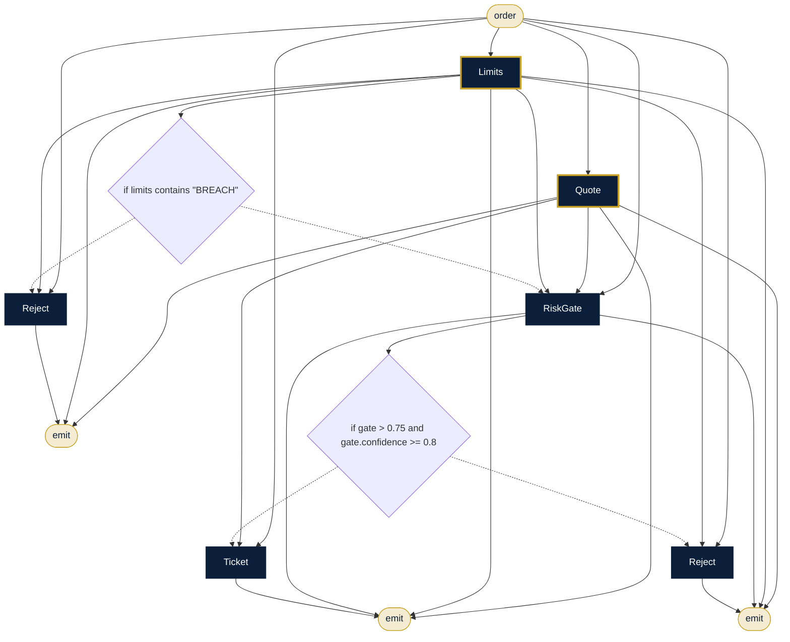

# Algo Trading Desk (QuantOracle™)

**Sector:** Capital markets · **Organisation:** AlgoProfessor QuantOracle desk (an example organisation; all data is synthetic)

> **Research and paper trading only. Not investment advice.** All market data is synthetic. Agents never send orders: every ticket goes to a named human. Live trading needs your broker's and the exchange's approvals for algorithmic orders. AlgoProfessor's live engine is [QuantOracle™](https://www.quant.algoprofessor.com).

**The problem.** An algorithmic trading desk must decide which strategies are robust enough to trade, check every order against hard risk limits before it reaches the market, and report risk and possible market abuse at the end of every day. Speed matters, but so do discipline, audit trails and a human hand on every live order.

**What this AlgoLang application does**

- Strategy review board: pulls backtest statistics and the desk's conduct rules, runs quant, compliance and editorial reviewers in parallel, then scores robustness as an `uncertain<score>` sampled five times
- A backtest that FAILS the desk thresholds (profit factor < 1.3 or drawdown > 15%) is sent back by a deterministic guard. No model is asked
- Approval is only ever for PAPER trading, and it goes to the human review queue
- Pre-trade risk gate: quote and risk-limit checks in parallel; a BREACH of any hard limit rejects the order with no model involved; otherwise a sampled risk score must be high and consistent before a paper order ticket is prepared for a person to approve
- End-of-day report: positions and P&L, stress test, risk level, and trade surveillance over every position in parallel
- Per-call cost and energy budgets, plus run caps; every call is priced in USD/INR, Wh and CO₂

## How the agents work together (`pre_trade_check.algo`)



## Programs

| Program | Input | Flow |
|---|---|---|
| `programs/strategy_review.algo` | `strategy` | Backtest ∥ desk rules → three reviewers → FAILS? revisions : robustness (uncertain) → paper approval or revisions |
| `programs/pre_trade_check.algo` | `order` | Quote ∥ limits → BREACH? reject : risk gate (uncertain) → paper ticket for human approval, or reject |
| `programs/eod_risk_report.algo` | `desk` | Book → stress → risk level → brief; surveillance over positions (parallel) → concern → report |

## Company tools (`plugins/`)

Agents can call a tool only if the program declares it, the agent lists it under `uses`, and `algo.config.json` allows it.

| Tool | What it does |
|---|---|
| `backtest.stats` | Backtest statistics and desk-threshold verdict (data/backtests.csv) |
| `market.quote` | Option chain: LTP, IV, OI, lot size (data/option_chain.csv) |
| `risk.limits` | Per-order, open-position and daily-loss limits against the live book (data/risk_limits.csv, positions.csv) |
| `book.positions` | Open positions and day P&L (data/positions.csv) |
| `kb.search` | Desk risk and conduct policy (kb/desk_risk_policy.md) |

## Governance (`algo.config.json`)

| Rule | Setting |
|---|---|
| Forbidden inputs (checked when the program compiles and again when it runs) | gender, caste, religion, pan_number, aadhaar, client_password |
| Human review below confidence | 0.85 (each agent's own threshold applies if it is stricter) |
| Max token budget per agent | 8,000 |
| Max tokens per run | 80,000 |
| Allowed tools | `kb.search`, `calc.eval`, `backtest.stats`, `market.quote`, `risk.limits`, `book.positions` |
| Audit | SHA-256 hash-chained log in `runs/`, checked with `algo audit verify` |

## Real-time (Kafka)

`programs/pre_trade_check.algo` ends with a `stream` block: order intents on `orders.intent` → pre-trade risk gate → `orders.decisions` / `orders.review` / `orders.dlq`. Every event runs the flow once under the same governance.

```bash
algo stream programs/pre_trade_check.algo --input data/order_events.jsonl                 # offline, no Kafka needed
docker compose -f ../../deploy/kafka/docker-compose.yml up -d  # ZooKeeper + Kafka
algo stream programs/pre_trade_check.algo --kafka --produce data/order_events.jsonl
algo stream programs/pre_trade_check.algo --kafka
```

The sample file includes a malformed event (and, for the trading desk, a re-delivered duplicate) so you can see dead-letter routing and de-duplication at work.

## Run it

Run these from this folder, so `algo.config.json` and the plugins load.

```bash
algo run programs/pre_trade_check.algo --arg "order=SELL 2 lots NIFTY 24500 CE weekly for STR-101, stop-loss 30%"
algo batch programs/pre_trade_check.algo --input data/order_intents.csv --workers 8      # every row, in parallel
algo review                     # approve or reject what was sent to a human
algo audit verify               # prove the audit log was not edited
algo report                     # usage, escalations and confidence per program
algo dev test tests             # 5 behaviour tests (offline, deterministic)
algo studio                     # open it in the graphical Studio
```

Add `--live` and set `ANTHROPIC_API_KEY` to use real Claude models instead of the offline agents.
