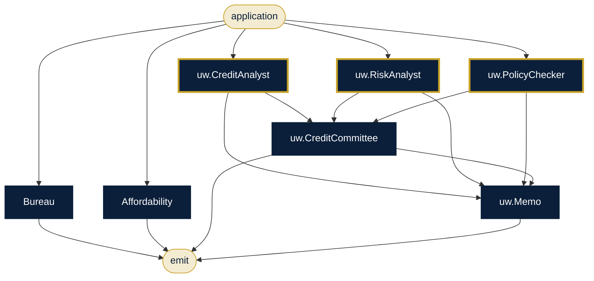

# Bank Credit & Onboarding

**Sector:** Banking · **Organisation:** Deccan Cooperative Bank (an example organisation; all data is synthetic)

**The problem.** Loan decisions and KYC onboarding need bureau data, affordability maths, sanctions screening and a committee view. They must be fair (no protected attributes) and auditable for the regulator.

**What this AlgoLang application does**

- Pulls the applicant's credit bureau record and computes the new EMI and debt-to-income ratio
- Credit analyst, risk analyst and policy checker review the application in parallel
- The credit committee scores the case and a decision memo is written. Low confidence goes to a human
- KYC: checks the customer file, screens names against the sanctions/PEP watchlist, rates risk and records the outcome
- Gender, caste, religion, nationality and marital status are forbidden inputs. The compiler rejects any agent that takes one

## How the agents work together (`loan_decision.algo`)



## Programs

| Program | Input | Flow |
|---|---|---|
| `programs/loan_decision.algo` | `application` | Bureau + DTI → three analysts in parallel → committee → memo |
| `programs/kyc_onboarding.algo` | `customer_file` | Documents → sanctions screen → verification → risk rating → outcome |

## Company tools (`plugins/`)

Agents can call a tool only if the program declares it, the agent lists it under `uses`, and `algo.config.json` allows it.

| Tool | What it does |
|---|---|
| `bureau.score` | Credit bureau records (data/bureau.csv) |
| `dti.calc` | New EMI at 9% p.a. and debt-to-income ratio against the 50% policy limit |
| `sanctions.screen` | Sanctions and PEP watchlist (data/watchlist.csv) |
| `file.read` | KYC files under data/kyc/ |

## Governance (`algo.config.json`)

| Rule | Setting |
|---|---|
| Forbidden inputs (checked when the program compiles and again when it runs) | gender, caste, religion, nationality, marital_status |
| Human review below confidence | 0.8 (each agent's own threshold applies if it is stricter) |
| Max token budget per agent | 8,000 |
| Max tokens per run | 80,000 |
| Allowed tools | `file.read`, `calc.eval`, `bureau.score`, `sanctions.screen`, `dti.calc` |
| Audit | SHA-256 hash-chained log in `runs/`, checked with `algo audit verify` |

## Run it

Run these from this folder, so `algo.config.json` and the plugins load.

```bash
algo run programs/loan_decision.algo --arg "application=APP-3101 home loan INR 45,00,000 for 20 years, net monthly income INR 1,80,000, salaried 9 years"
algo batch programs/loan_decision.algo --input data/loan_applications.csv --workers 8      # every row, in parallel
algo review                     # approve or reject what was sent to a human
algo audit verify               # prove the audit log was not edited
algo report                     # usage, escalations and confidence per program
algo dev test tests             # 4 behaviour tests (offline, deterministic)
algo studio                     # open it in the graphical Studio
```

Add `--live` and set `ANTHROPIC_API_KEY` to use real Claude models instead of the offline agents.
