# AlgoBharat Bhasha Desk™

**Sector:** Indian-language AI for citizen services · **Organisation:** an example municipal desk (all queries are synthetic)

**The problem.** Citizens write to public services in their own language and script: Telugu, Hindi, Tamil, Marathi, Bengali, Kannada, Gujarati, or Hindi typed in Latin letters. Many desks reply only in English, and officers cannot read every script. Free machine translation is risky for official replies.

**What this AlgoLang application does**

- **Detects the language from the script**: Devanagari, Bengali, Gurmukhi, Gujarati, Odia, Tamil, Telugu, Kannada, Malayalam, Urdu/Arabic and Latin. It separates **Hindi from Marathi** by marker words, recognises **Hindi written in Latin letters** by common romanised words, and flags code-mixed text.
- **Transliterates** any Brahmic script to Latin letters (ISO 15919 style): inherent vowel, vowel signs, virama, anusvara, Dravidian long ē/ō, and Hindi word-final schwa deletion. An officer who does not read Telugu can still read *nā piṁchan mūḍu nelalugā rālēdu*.
- **Finds the need** (pension, ration card, electricity, water, scholarship, land records) from a multilingual lexicon, with transliteration **in parallel**.
- **Answers in the citizen's own language** from **approved templates**, never with free-form machine translation. A query with no recognisable need goes to an officer.
- Measures itself on a **4,800-query multilingual test set** with greetings, unseen phrasings and code-mixing. It reports 99.3% language accuracy and 97.5% intent accuracy; Marathi is the weakest at 92%, because short Marathi queries can look like Hindi.

## How it works: live figure

<p align="center"></p>

## What the tools return

```
LANGUAGE Telugu (te) · Telugu script, 100% of letters
LATIN nā piṁchan mūḍu nelalugā rālēdu, dayacēsi sahāyaṁ cēyaṁḍi
INTENT pension (matched: పింఛన్)
REPLY [Telugu] మీ పింఛన్ అభ్యర్థన అందింది. సూచన సంఖ్య: BH-FCCD53. ఒక అధికారి 3 పని దినాల్లో మిమ్మల్ని సంప్రదిస్తారు.

LANGUAGE Marathi (mr) · Devanagari script          INTENT land_records (matched: सातबारा)
LANGUAGE Hindi in Latin letters (hi-Latn)          INTENT ration_card (matched: ration)
```

## Company tools (`plugins/bhasha_tools.py`)

| Tool | What it does |
|---|---|
| `lang.detect` | Script detection over Unicode blocks; Hindi/Marathi and English/Hinglish disambiguation |
| `lang.transliterate` | Brahmic scripts to Latin letters by shared ISCII-derived code-point offsets |
| `lang.intent` | Need detection from `data/lexicon.json` (9 language variants × 6 services) |
| `lang.reply` | Approved acknowledgement from `data/replies.json`, with a reference number |
| `lang.coverage` | Language and intent accuracy per language on 4,800 synthetic queries |

The reply templates were written for this example. **Have native-speaking officers review them before real use.**

## Run it

```bash
cd enterprise-apps/bharat-language-desk
algo run programs/bhasha_desk.algo --arg "query=నా పింఛన్ మూడు నెలలుగా రాలేదు"
algo batch programs/bhasha_desk.algo --input data/citizen_queries.csv
algo eval programs/bhasha_desk.algo
```

Pure Python; no extra packages. AlgoLang keeps every Indian script exactly as written, including inside program strings.
