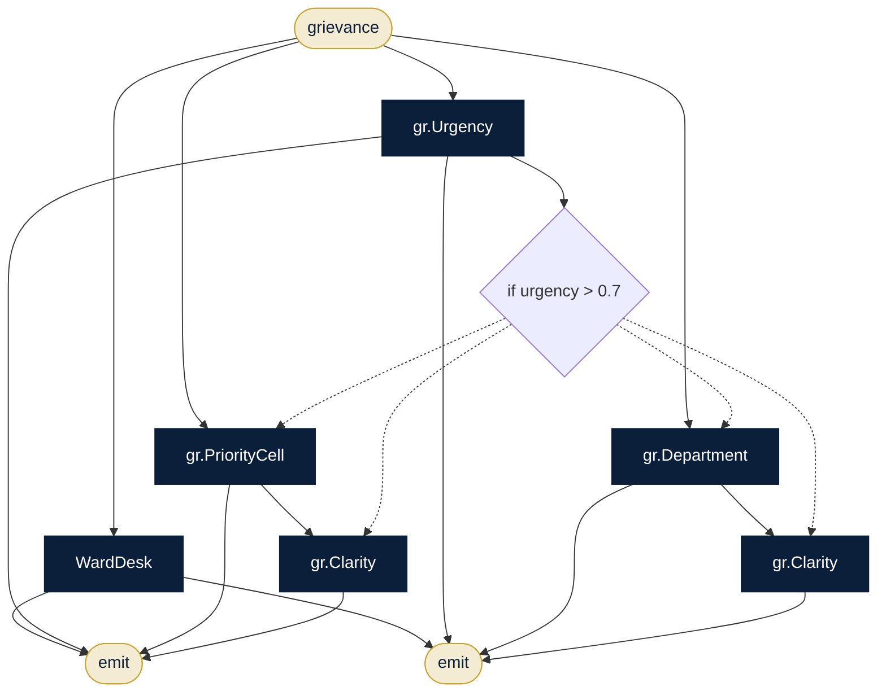

# Citizen Services Desk

**Sector:** Government & public services · **Organisation:** Municipal Corporation Citizen Services (an example organisation; all data is synthetic)

**The problem.** Citizens' complaints must reach the right department fast, urgent ones (health, safety, children, the elderly) must be prioritised, and every reply must be clear. Welfare eligibility checks must be fair and reviewed.

**What this AlgoLang application does**

- Finds the ward, department, desk and service-level target for each grievance
- Scores urgency. Urgent → priority cell with an action plan; otherwise routed to the department
- Checks every reply for clarity before it is sent
- Welfare pre-check: extracts the facts, applies scheme rules and scores eligibility for the scheme officer

## How the agents work together (`grievance_desk.algo`)



## Programs

| Program | Input | Flow |
|---|---|---|
| `programs/grievance_desk.algo` | `grievance` | Ward directory → urgency → priority cell or department → clarity |
| `programs/welfare_check.algo` | `application` | Facts → scheme rules → eligibility (human review) → notice |

## Company tools (`plugins/`)

Agents can call a tool only if the program declares it, the agent lists it under `uses`, and `algo.config.json` allows it.

| Tool | What it does |
|---|---|
| `ward.directory` | Departments, desks and targets (data/departments.csv) |
| `kb.search` | Citizen charter and scheme rules (kb/) |

## Governance (`algo.config.json`)

| Rule | Setting |
|---|---|
| Forbidden inputs (checked when the program compiles and again when it runs) | gender, caste, religion, nationality |
| Human review below confidence | 0.75 (each agent's own threshold applies if it is stricter) |
| Max token budget per agent | 8,000 |
| Max tokens per run | 80,000 |
| Allowed tools | `kb.search`, `ward.directory` |
| Audit | SHA-256 hash-chained log in `runs/`, checked with `algo audit verify` |

## Run it

Run these from this folder, so `algo.config.json` and the plugins load.

```bash
algo run programs/grievance_desk.algo --arg "grievance=Water supply in ward 7 is muddy for three days, elderly residents are falling sick"
algo batch programs/grievance_desk.algo --input data/grievances.csv --workers 8      # every row, in parallel
algo review                     # approve or reject what was sent to a human
algo audit verify               # prove the audit log was not edited
algo report                     # usage, escalations and confidence per program
algo dev test tests             # 2 behaviour tests (offline, deterministic)
algo studio                     # open it in the graphical Studio
```

Add `--live` and set `ANTHROPIC_API_KEY` to use real Claude models instead of the offline agents.
