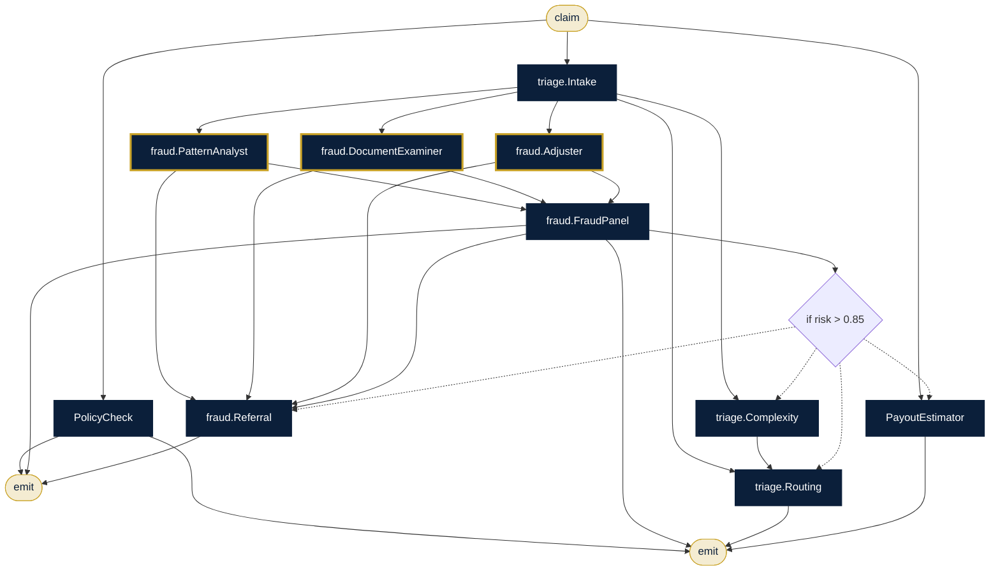

# Claims Operations Center

**Sector:** Insurance · **Organisation:** NovaShield General Insurance (an example organisation; all data is synthetic)

**The problem.** Claims handlers spend hours on first notice of loss: checking the policy, screening for fraud, deciding the route and estimating the payout. Suspicious claims slip through, and simple ones wait in the same queue as complex ones.

**What this AlgoLang application does**

- Reads the claim and pulls the policy (cover, deductible, status) from the policy database
- Runs a three-member fraud panel in parallel: pattern analyst, document examiner, adjuster
- High fraud score → writes a referral note for the Special Investigations Unit (SIU) and stops
- Otherwise → scores complexity, chooses a handling route and estimates the payout after the deductible
- A second program answers policyholder messages with live policy facts and a tone check

## How the agents work together (`claims_intake.algo`)



## Programs

| Program | Input | Flow |
|---|---|---|
| `programs/claims_intake.algo` | `claim` | FNOL → policy → fraud panel → SIU referral or triage, routing and payout |
| `programs/customer_desk.algo` | `query` | Policyholder message → policy facts → claims or policy desk → clarity check |

## Company tools (`plugins/`)

Agents can call a tool only if the program declares it, the agent lists it under `uses`, and `algo.config.json` allows it.

| Tool | What it does |
|---|---|
| `policydb.lookup` | Policy database (data/policies.csv): cover, sum insured, deductible, status |
| `payout.estimate` | Payout = claimed amount − deductible, capped at the sum insured |
| `kb.search` | Claims manual (kb/claims_manual.md) |

## Governance (`algo.config.json`)

| Rule | Setting |
|---|---|
| Forbidden inputs (checked when the program compiles and again when it runs) | gender, caste, religion, nationality |
| Human review below confidence | 0.7 (each agent's own threshold applies if it is stricter) |
| Max token budget per agent | 8,000 |
| Max tokens per run | 80,000 |
| Allowed tools | `kb.search`, `policydb.lookup`, `payout.estimate` |
| Audit | SHA-256 hash-chained log in `runs/`, checked with `algo audit verify` |

## Run it

Run these from this folder, so `algo.config.json` and the plugins load.

```bash
algo run programs/claims_intake.algo --arg "claim=NS-10571: scratch on the left door in a parking lot, no third party, estimate INR 6,500"
algo batch programs/claims_intake.algo --input data/claims_batch.csv --workers 8      # every row, in parallel
algo review                     # approve or reject what was sent to a human
algo audit verify               # prove the audit log was not edited
algo report                     # usage, escalations and confidence per program
algo dev test tests             # 3 behaviour tests (offline, deterministic)
algo studio                     # open it in the graphical Studio
```

Add `--live` and set `ANTHROPIC_API_KEY` to use real Claude models instead of the offline agents.
