# AlgoCare Remote Monitoring™

**Sector:** Healthcare and digital health · **Organisation:** an example home-monitoring service (all patients are synthetic; no names are stored) · **Risk level: high**

**The problem.** Thousands of patients are monitored at home after surgery or with chronic illness. Their devices send readings all day. A deteriorating patient must be spotted within minutes, a dangerous combination of medicines must not be missed, and every alert must reach a clinician who decides. The system must never use a patient's religion, caste or income.

**What this AlgoLang application does**

- Scores each reading with **NEWS2** (Royal College of Physicians, 2017; SpO₂ scale 1), exactly by the published bands for respiration rate, oxygen saturation, supplemental oxygen, systolic blood pressure, pulse, consciousness and temperature. It maps the total to the clinical response band.
- Looks up the patient's record **in parallel** (age, conditions, medicines, last three scores) and checks the medicines for well-known **major interactions**, such as warfarin with aspirin, or sertraline with tramadol.
- Routes by severity: **high risk** → emergency alert; **medium risk or a major interaction** → urgent review within the hour; otherwise → a routine note. **A clinician reviews every alert.**
- A second flow scans **all 5,000 patients** for risk bands and **rising scores** (3 or more points over three readings), and builds the nurse's call list.
- A **real-time stream** on AlgoPulse scores each device reading as it arrives, de-duplicates re-sent readings and dead-letters unreadable ones.

## How it works: live figure

<p align="center"></p>

## What the tools return

```
NEWS2 16 · HIGH RISK for PT-20044: emergency assessment by a clinical team; consider transfer to hospital
respiration rate 3 · SpO2 (scale 1) 3 · supplemental oxygen 2 · systolic BP 2 · pulse 2 · consciousness 3 · temperature 1

COHORT 5,000 patients · RISING 296 · high risk 122 · medium risk 112 · low-medium risk 10 · low risk 1,023 · no added risk 3,733
MAJOR INTERACTION: amiodarone + digoxin (major: digoxin toxicity); aspirin + warfarin (major: bleeding risk)
```

## Trustworthy AI (v0.4), as the compiler requires for high risk

- `disclose`: patients are told alerts come from an AI-supported system and that a clinician decides.
- `redact pii`, and `forbid caste, religion` plus the organisation's `income`: masked or withheld before any model call.
- `explain with evidence` on every agent; a clinician reviews every alert (`require human for always`).
- **Fairness tests:** the same reading gets the same decision whatever the patient's religion or caste. **Robustness tests:** typos and reordering do not change it.
- Signed audit logs (Ed25519), kept for 10 years; traces for 90 days.

> Decision support only, for clinicians. Not a medical device and not clinical advice. The interaction table is a small teaching set; SpO₂ scale 2 and local protocols are not modelled.

## Run it

```bash
cd enterprise-apps/digital-health-monitor
algo run programs/remote_monitoring.algo --arg "reading=PT-20044 RR 26, SpO2 91 on oxygen 2 L/min, BP 92, pulse 124, new confusion, temp 38.9"
algo run programs/remote_monitoring.algo --flow cohort --arg "request=today's round"
algo stream programs/remote_monitoring.algo --input data/vitals_events.jsonl
algo eval programs/remote_monitoring.algo
```

Pure Python; no extra packages.
