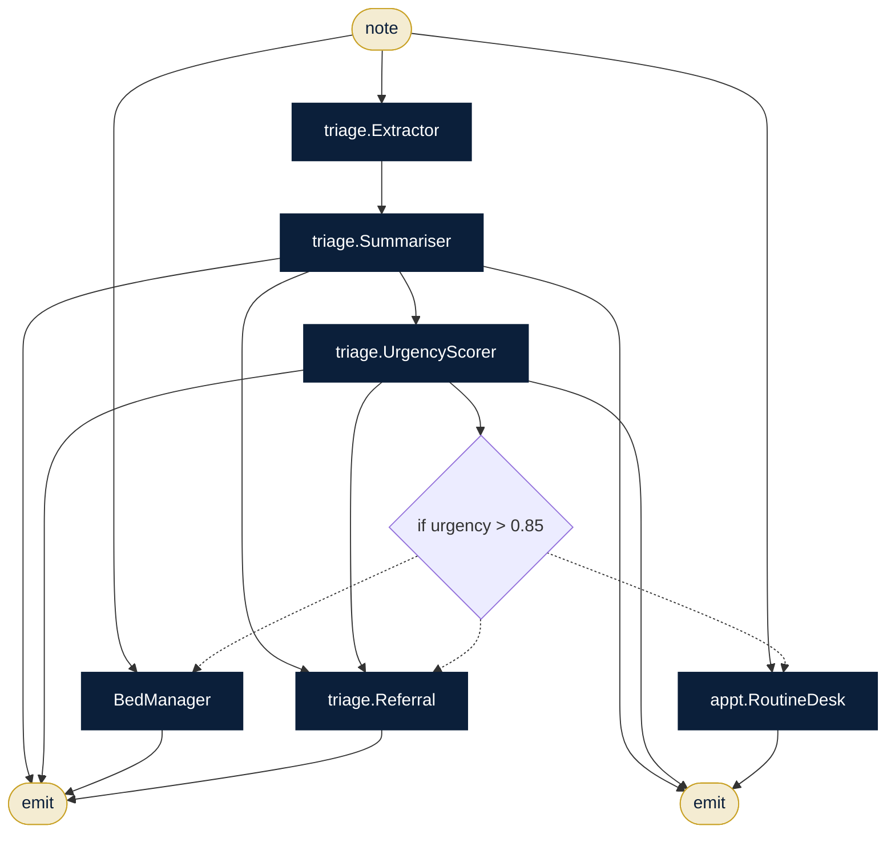

# Hospital Care Coordination

**Sector:** Healthcare · **Organisation:** Sunrise Multispeciality Hospital (an example organisation; all data is synthetic)

> **Decision support only.** Every output is reviewed and signed by a qualified clinician. All records are synthetic.

**The problem.** Emergency departments must triage quickly, find a bed and hand over cleanly, then write discharge summaries that are clear for patients. Every step is time-critical and must stay under a clinician's control.

**What this AlgoLang application does**

- Extracts the key facts from an ER note and writes a structured summary
- Scores urgency. Every score below the threshold goes to the duty clinician (human-in-the-loop)
- Urgent → checks the live bed board for a suitable ward and drafts a referral note
- Not urgent → offers the next routine appointment
- A second program drafts the discharge summary from the inpatient record file for the doctor to approve

## How the agents work together (`er_triage.algo`)



## Programs

| Program | Input | Flow |
|---|---|---|
| `programs/er_triage.algo` | `note` | ER note → facts → summary → urgency → bed + referral, or routine booking |
| `programs/discharge.algo` | `record` | Record file → draft → check → final discharge summary |

## Company tools (`plugins/`)

Agents can call a tool only if the program declares it, the agent lists it under `uses`, and `algo.config.json` allows it.

| Tool | What it does |
|---|---|
| `beds.availability` | Live bed board by ward (data/beds.csv) |
| `file.read` | Inpatient records under data/records/ |
| `kb.search` | Clinical pathways (kb/clinical_pathways.md) |

## Governance (`algo.config.json`)

| Rule | Setting |
|---|---|
| Forbidden inputs (checked when the program compiles and again when it runs) | caste, religion, gender, income |
| Human review below confidence | 0.85 (each agent's own threshold applies if it is stricter) |
| Max token budget per agent | 6,000 |
| Max tokens per run | 80,000 |
| Allowed tools | `kb.search`, `file.read`, `beds.availability` |
| Audit | SHA-256 hash-chained log in `runs/`, checked with `algo audit verify` |

## Run it

Run these from this folder, so `algo.config.json` and the plugins load.

```bash
algo run programs/er_triage.algo --arg "note=62-year-old with crushing chest pain for 40 minutes, sweating, ECG shows ST elevation"
algo batch programs/er_triage.algo --input data/er_notes.csv --workers 8      # every row, in parallel
algo review                     # approve or reject what was sent to a human
algo audit verify               # prove the audit log was not edited
algo report                     # usage, escalations and confidence per program
algo dev test tests             # 3 behaviour tests (offline, deterministic)
algo studio                     # open it in the graphical Studio
```

Add `--live` and set `ANTHROPIC_API_KEY` to use real Claude models instead of the offline agents.
