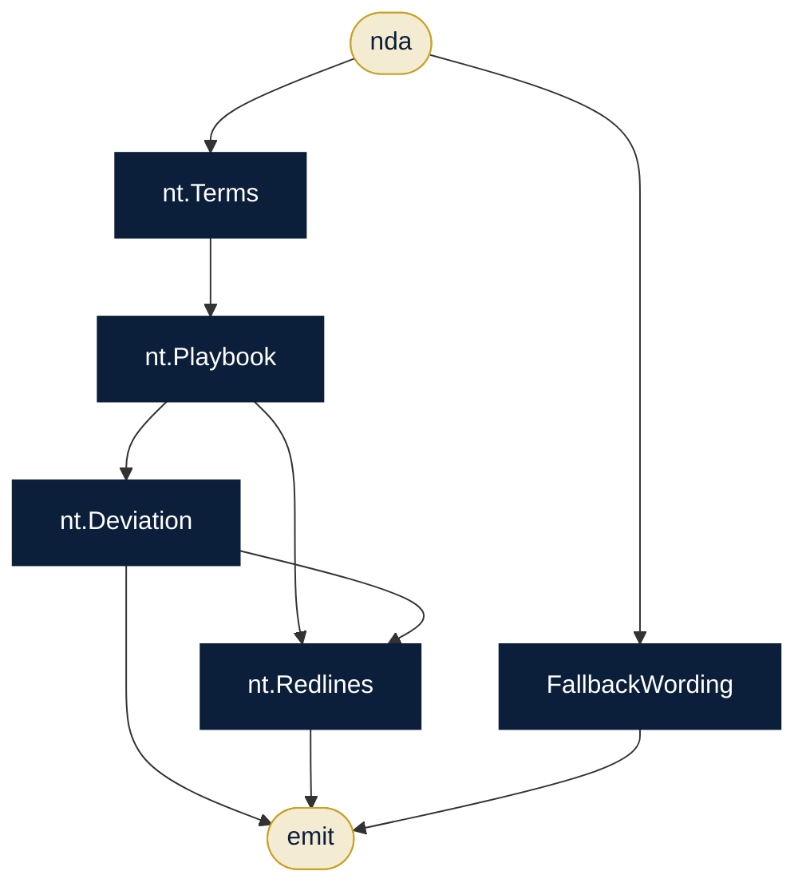

# Legal Contract Desk

**Sector:** Legal & compliance · **Organisation:** Meridian Technologies Legal (an example organisation; all data is synthetic)

**The problem.** In-house legal teams review dozens of NDAs and contracts a week against the same playbook. Most of the work is spotting deviations and inserting approved fallback wording.

**What this AlgoLang application does**

- Extracts NDA terms, compares them with the legal playbook and scores the deviation
- Suggests redlines and pulls Meridian's approved fallback wording from the clause library
- For contracts: reads the file, analyses every clause in parallel, scores the risk and summarises it for counsel

## How the agents work together (`nda_triage.algo`)



## Programs

| Program | Input | Flow |
|---|---|---|
| `programs/nda_triage.algo` | `nda` | Terms → playbook → deviation → redlines + approved fallbacks |
| `programs/contract_review.algo` | `contract` | Clauses → analysts (parallel) → risk → summary + fallbacks |

## Company tools (`plugins/`)

Agents can call a tool only if the program declares it, the agent lists it under `uses`, and `algo.config.json` allows it.

| Tool | What it does |
|---|---|
| `clause.library` | Approved clause wording (data/clause_library.csv) |
| `file.read` | Contracts under data/contracts/ |
| `kb.search` | Legal playbook (kb/legal_playbook.md) |

## Governance (`algo.config.json`)

| Rule | Setting |
|---|---|
| Forbidden inputs (checked when the program compiles and again when it runs) | gender, caste, religion, nationality |
| Human review below confidence | 0.8 (each agent's own threshold applies if it is stricter) |
| Max token budget per agent | 8,000 |
| Max tokens per run | 80,000 |
| Allowed tools | `kb.search`, `file.read`, `clause.library` |
| Audit | SHA-256 hash-chained log in `runs/`, checked with `algo audit verify` |

## Run it

Run these from this folder, so `algo.config.json` and the plugins load.

```bash
algo run programs/nda_triage.algo --arg "nda=Mutual NDA with Nimbus Analytics: perpetual confidentiality, governing law Delaware, unlimited liability, 24-month non-solicit"
algo batch programs/nda_triage.algo --input data/ndas.csv --workers 8      # every row, in parallel
algo review                     # approve or reject what was sent to a human
algo audit verify               # prove the audit log was not edited
algo report                     # usage, escalations and confidence per program
algo dev test tests             # 2 behaviour tests (offline, deterministic)
algo studio                     # open it in the graphical Studio
```

Add `--live` and set `ANTHROPIC_API_KEY` to use real Claude models instead of the offline agents.
