# AlgoGraph™ LLM & SLM Optimizer

**Graph optimisation for large-scale language-model systems.** Every AlgoLang program is a graph of agents. This application reads that graph from the compiler, chooses the cheapest large (LLM) or small (SLM) model for every agent that still meets its quality floor and the end-to-end latency limit, proves the choice optimal, and routes live traffic small-model-first.

| | |
|---|---|
| **Sector** | AI platform engineering · MLOps |
| **Programs** | `cascade_router.algo` (limited risk) · `graph_optimizer.algo` (minimal risk) |
| **Tools** | `slm.triage`, `graph.analyze`, `graph.optimize` (`plugins/graph_tools.py`), built-in `kb.search` |
| **Models** | `local:phi-4-mini` (SLM, on your own GPUs), `claude-haiku-5-5`, `claude-opus-5-5` |

## 1. SLM-first cascade: `cascade_router.algo`

<p align="center"></p>

```algo
model slm = "local:phi-4-mini"         // a small model on our own GPUs
model llm = "claude-opus-5-5"          // a large model for hard requests

flow main(request: text) {
    t = Triage(request)
    if t contains "COMPLEX" {                          // decided in code: no model guesses the route
        emit t, LargeAnswer(request, t)
    } else {
        draft = SmallAnswer(request)                   // uncertain<text>, sampled 3×
        if draft.confidence >= 0.88 { emit t, draft }  // the small model agrees with itself: done
        else { emit t, draft, LargeAnswer(request, draft) }
    }
}
```

The cascade is written with the language's own features: a **deterministic guard** sends clearly complex requests straight to the large model, and **`uncertain<T>`** sampling measures whether the small model agrees with itself. Only uncertain answers pay for the large model. Every call is priced (local models cost no API fees and use far less energy), audited and governed like any other.

## 2. Exact graph optimisation: `graph_optimizer.algo`

<p align="center"></p>

```text
$ algo run programs/graph_optimizer.algo --arg "target=../claims-ops-center/programs/claims_intake.algo" \
      --arg "constraints=quality >= 0.8 and latency <= 12 s"

VERIFIED optimal model assignment for claims_intake (exhaustive branch and bound, 37 nodes explored;
brute force over 124,416 combinations agrees)
cost per request $0.02322 vs $0.26151 with claude-opus-5-5 everywhere (91% lower) · critical path 8.0 s
(limit 12.0 s; all-claude-opus-5-5 21.0 s) · energy 1.070 Wh vs 4.508 Wh
small models: 4 of 10 agents run on SLMs
```

How it works:

1. **The graph comes from the compiler.** `graph.analyze` compiles the target program and takes its data-flow graph: agents, parallel `par` groups, `if` branches and dependencies.
2. **Each agent gets a task class and a quality floor:** extraction, classification, reasoning, writing or review, from its name, goal and role. Agents that decide, or whose results people review, need +0.05.
3. **Exact optimisation.** Minimise the cost per request, subject to every agent meeting its floor and the critical path (parallel agents overlap; branches count at worst case) staying within the latency limit. Branch and bound is exhaustive. When the search space is small enough, brute force checks it and must agree, or the result is an error.
4. **Governed rollout.** Only a `VERIFIED` plan is reviewed (an `uncertain<score>` reliability review), and changing production models needs **two approvals** (`require approvals 2`). The plan is applied with `"agent_models"` in `algo.config.json`, without editing the program.

An impossible target (for example a 3-second limit on the credit committee) is reported as `INFEASIBLE`, with the fastest possible critical path, and is never rolled out.

## Small models on your own GPUs

```json
"models": {"slm": "local:phi-4-mini"},
"local_models": {"base_url": "http://localhost:11434/v1", "api_key_env": "LOCAL_LLM_KEY", "timeout_s": 60},
"pricing": {"local:*": [0, 0]},
"energy": {"wh_per_1k_tokens": {"local:*": 0.03}}
```

Any OpenAI-compatible server works: Ollama, vLLM, llama.cpp server, LM Studio. Model ids start with `local:`. With `--live`, `local:` agents go to your server and the others to Claude. Without `ANTHROPIC_API_KEY`, programs that use only local models still run live.

> Benchmark scores and prices in `data/model_catalog.csv` are illustrative. Replace them with your own eval results (`algo eval --live`) and contracted prices before relying on the optimiser.

## Run it

```bash
cd enterprise-apps/llm-graph-optimizer
algo eval programs/cascade_router.algo
algo eval programs/graph_optimizer.algo
algo batch programs/cascade_router.algo --input data/requests.csv
algo dev test tests
```
