# AlgoML Model Factory™

**Sector:** Machine learning and deep learning · **Organisation:** AlgoML Model Factory (an example organisation; all data is synthetic)

**The problem.** Teams train many models, but shipping one safely needs more than a high score: a fair comparison with a simple baseline, calibrated probabilities, no leaking features, stable production data, and people who sign off. Most of that lives in notebooks and memory.

**What this AlgoLang application does**

- Trains three model families **in parallel**, each with stratified 5-fold cross-validation on 6,000 customers, written with NumPy only:
  - logistic regression;
  - a **deep neural network** (two ReLU hidden layers, He initialisation, Adam, early stopping);
  - **gradient-boosted decision trees** (logistic loss, quantile splits).
- Chooses a **calibrated champion**: best AUC among models whose expected calibration error is at most 0.05, and reports its lift over the baseline on the same folds. On this data, logistic regression wins, because the ground truth is mostly linear. The app says so rather than favouring the more complex model.
- **Catches target leakage** before any training: a column that predicts the label on its own (AUC above 0.97) stops the run.
- **Checks production drift** with the population stability index (PSI) for every feature; a drifted week goes to retraining, never to deployment.
- An `uncertain<score>` model-risk review (sampled 5 times), then a deployment plan that **two different MLOps engineers** must approve, with reasons and evidence.

## How it works: live figure

<p align="center"></p>

## What the tools return

```
CHAMPION logistic regression: AUC 0.807, calibration error 0.022
  logistic regression                      AUC 0.807 ± 0.009  ECE 0.022  accuracy 89.8%
  deep neural network (32-16, Adam)        AUC 0.789 ± 0.007  ECE 0.017  accuracy 89.5%
  gradient-boosted trees (120 × depth 2)   AUC 0.789 ± 0.013  ECE 0.017  accuracy 89.5%

DRIFT DETECTED in week 46: monthly_charges (PSI 0.60), support_tickets (PSI 0.51), usage_gb (PSI 0.30)
LEAKAGE in customers_with_refunds.csv: refund_issued (AUC 1.000 on its own) predicts the label almost perfectly
```

## Company tools (`plugins/ml_tools.py`)

| Tool | What it computes |
|---|---|
| `data.profile` | Rows, features, class balance, missing values, single-feature AUC leakage scan |
| `ml.train` | One family with stratified 5-fold CV: AUC (Mann–Whitney), accuracy, expected calibration error |
| `ml.compare` | All families on the same folds; calibrated champion and lift over the baseline |
| `ml.drift` | PSI of every feature, training data vs `data/production_week45.csv` or `…46.csv` |

## Governance

Limited risk (it shapes offers to customers), so the program discloses AI use. Personal data is masked before any model call, calls below 0.75 confidence go to the review queue, deployment needs two approvers, and every call is in the audit log. `kb/model_governance.md` holds the deployment standard the risk review cites.

## Run it

```bash
cd enterprise-apps/ml-model-factory
algo run programs/model_factory.algo --arg "request=Churn model on the customer dataset, production WEEK-45"
algo eval programs/model_factory.algo
algo batch programs/model_factory.algo --input data/model_requests.csv
```

Requires NumPy (`pip install "algolang[dev]"` or `pip install numpy`).
