# AlgoBio Network Lab™

**Sector:** Computational and network biology · **Organisation:** an example research group (all proteins, pathways and sequences are synthetic)

**The problem.** Disease genes cluster in the protein interaction network, so known disease proteins can point to new candidates. But network methods produce impressive-looking lists even from random input. Target discovery needs validation, a negative control and proper statistics before a lab spends money on experiments.

**What this AlgoLang application does**

- Analyses a **1,500-protein, 7,441-interaction network** **in parallel**:
  - **hubs** by degree;
  - **bottlenecks** by betweenness centrality (Brandes' algorithm on 400 sampled sources);
  - **communities** by label propagation, with Newman's **modularity** Q.
- **Prioritises candidate disease proteins** by **random walk with restart** from 28 known disease proteins, and **validates** the ranking: 12 known disease proteins were hidden, and the tool reports how many reappear among the top 100 candidates, with AUROC.
- Runs a **negative control**, prioritising from 28 random proteins. The control must look weak; if it looked as convincing as the real seeds, the result would reflect network structure, not biology.
- Tests **pathway enrichment** of the candidates with the hypergeometric test and **Benjamini–Hochberg FDR** control.
- A hypothesis review (`uncertain<score>`, 5 samples) leads to a wet-lab plan that **two people approve**, or to more analysis.
- A second flow analyses DNA sequences: GC content, the **longest open reading frame on all six frames**, and common 3-mers. It calls a sequence protein-coding only with an ORF of 150+ codons, because random GC-rich DNA produces long ORFs by chance.

## How it works: live figure

<p align="center"></p>

## What the tools return

```
MODULES 9 communities of 5+ proteins · modularity Q 0.687 · disease module: 28 of 28 seeds fall in one community
STRONG EVIDENCE: 12 of 12 hidden disease proteins recovered in the top 100 candidates · AUROC 0.999
ENRICHED 4 pathway(s) at FDR < 0.05     PW-07 inflammatory response  23/61  p 9.42e-11  q 1.26e-09

negative control (28 random seeds):
WEAK EVIDENCE: 3 of 12 hidden disease proteins recovered · AUROC 0.836 · NO ENRICHED PATHWAY at FDR < 0.05

SEQUENCE SEQ-01 LIKELY PROTEIN-CODING (an ORF of 150+ codons): longest ORF 321 codons on frame +1
SEQUENCE SEQ-02 PROBABLY NON-CODING (no ORF of 150+ codons): GC 59.7%, longest ORF 110 codons
```

## Company tools (`plugins/bio_tools.py`)

| Tool | Method |
|---|---|
| `net.centrality` | Degree; Brandes betweenness (sampled sources, seeded) |
| `net.modules` | Label propagation; Newman modularity |
| `net.propagate` | Random walk with restart; held-out recovery and AUROC; negative control |
| `bio.enrich` | Hypergeometric test; Benjamini–Hochberg FDR |
| `bio.sequence` | GC content, six-frame ORF search, 3-mer counts |

Pure Python; no extra packages.

## Run it

```bash
cd enterprise-apps/network-biology-lab
algo run programs/target_discovery.algo --arg "question=Prioritise targets for the inflammatory disease from its known seed proteins"
algo run programs/target_discovery.algo --flow sequence --arg "sequence=SEQ-01"
algo eval programs/target_discovery.algo
```
