# AlgoNLP Document Intelligence™

**Sector:** Natural language processing · **Organisation:** an example bank (all messages are synthetic)

**The problem.** A bank receives thousands of messages a week: card blocks, loan questions, KYC updates, statement requests, complaints and fraud reports. Each one must reach the right team fast, and a sudden rise in one kind of message, such as a fraud wave, must be seen as a trend, not as scattered tickets.

**What this AlgoLang application does**

- For every message, **in parallel**:
  - **classifies** it with multinomial Naive Bayes on unigrams and bigrams, trained on weeks 1–9 of a 3,000-message corpus and reported with held-out **macro-F1 0.893** on weeks 10–12;
  - **extracts entities**: amounts, dates, card endings, branches, banks, and channels such as UPI, OTP and ATM;
  - **summarises** it with **TextRank**, a sentence graph ranked by PageRank.
- Adds **corpus-level context**: weekly volume per category, **emerging topics** (latest two weeks against the eight before), and the most distinctive words per category by log-odds. In the sample data, fraud reports rise by about 140% in weeks 11–12.
- Routes fraud reports to an investigations case that **a person always reviews**, with reasons and evidence. Everything else gets a reply draft for the right queue.
- Personal data is masked before any language model sees a message. The eval block includes a **robustness test**: typos and reordering must not change the routing.

The corpus is deliberately imperfect, like real mail: 15% of messages mix two topics, words are dropped, and 4% are filed under the wrong category. That is why the classifier is honest at about 89% rather than a suspicious 100%.

## How it works: live figure

<p align="center"></p>

## What the tools return

```
CATEGORY FRAUD REPORT (probability 1.000; next statement request 0.000)
model: multinomial Naive Bayes, unigrams + bigrams · held-out weeks 10-12: macro-F1 0.893, accuracy 89.6% on 750 messages
ENTITIES MONEY: Rs 45,000 · DATE: 3/11/2026 · BANK: Deccan Bank · CHANNEL: OTP
SUMMARY Someone withdrew Rs 45,000 from my account on 3/11/2026 without my knowledge.  (1 of 3 sentences, TextRank)
EMERGING FRAUD REPORT (+143%) in weeks 11-12
```

## Company tools (`plugins/nlp_tools.py`)

| Tool | What it computes |
|---|---|
| `nlp.classify` | Naive Bayes category and probability; held-out macro-F1 and accuracy |
| `nlp.entities` | Rule-based named entities for Indian banking messages |
| `nlp.summarize` | TextRank extractive summary |
| `nlp.trends` | Weekly volume per category, emerging topics, distinctive words (log-odds) |

Pure Python; no extra packages.

## Run it

```bash
cd enterprise-apps/nlp-document-intelligence
algo run programs/document_triage.algo --arg "message=Someone withdrew Rs 45,000 from my account without my knowledge."
algo batch programs/document_triage.algo --input data/triage_requests.csv
algo eval programs/document_triage.algo
```
