# AlgoEng Predictive Maintenance™

**Sector:** Data-driven engineering · **Organisation:** an example plant operator with 1,000 pumps at five sites (all data is synthetic)

**The problem.** Unplanned pump failures stop production and can be dangerous. Vibration and health data show most failures coming weeks ahead, but nobody can read 1,000 spectra a week. Even when the warnings are seen, the maintenance crews may not reach every pump in time.

**What this AlgoLang application does**

- **Vibration analysis** for any pump, **in parallel** with prognosis:
  - It synthesises one second of vibration velocity from the pump's speed, bearing geometry and condition.
  - It measures RMS velocity, crest factor and kurtosis, then reads the **FFT** at 1× running speed (imbalance), 2× (misalignment) and the **bearing outer-race fault frequency (BPFO)**.
  - It assigns a severity zone in the style of **ISO 10816-3** (A good, B acceptable, C plan repair, D act now).
- **Remaining useful life:** an exponential degradation fit to 26 weeks of health index (log-linear least squares), extrapolated to the failure threshold with a **90% interval**.
- Routes each pump: **failure within 4 weeks or zone D** → an urgent work order that a person approves; **zone C or failure within 12 weeks** → planned repair; otherwise → monitoring.
- A **fleet flow** scans all 1,000 pumps in about a second, finds the urgent ones, **schedules them across three crews, earliest deadline first**, reports any pump that cannot be reached before its predicted failure, and sends the schedule to **two managers** to approve.
- It reports its own accuracy: the diagnosis agrees with the recorded condition for **93.6%** of pumps. Misalignment is the hardest fault to separate from bearing wear.

## How it works: live figure

<p align="center"></p>

## What the tools return

```
ZONE C · BEARING OUTER RACE on PMP-3026 (Jamnagar, 1480 rpm, 15 kW): velocity 3.07 mm/s RMS
FAILURE WITHIN 4 WEEKS: PMP-3026 remaining life 4.7 weeks (90% interval 3.6-5.7) to health index 0.5

FLEET 1,000 pumps · URGENT 20 (failure possible within 4 weeks) · zones A 769 · B 172 · C 59 · D 0
diagnosis agrees with the recorded condition for 93.6%
SCHEDULED all 20 urgent pumps in 4 working days with 3 crews × 2 jobs/day (earliest deadline first)
```

## Company tools (`plugins/maintenance_tools.py`)

| Tool | Method |
|---|---|
| `vib.diagnose` | Signal synthesis, RMS / crest / kurtosis, Hann-windowed FFT, fault-frequency matching, severity zones |
| `rul.estimate` | Log-linear least-squares degradation fit; 90% interval from residuals |
| `fleet.scan` | All pumps: zones, fault types, diagnostic agreement, shortest lives |
| `maint.plan` | Earliest-deadline-first crew scheduling; capacity shortfalls |

Requires NumPy.

## Run it

```bash
cd enterprise-apps/predictive-engineering
algo run programs/maintenance_planner.algo --arg "asset=PMP-3026"
algo run programs/maintenance_planner.algo --flow fleet --arg "request=weekly reliability review"
algo batch programs/maintenance_planner.algo --input data/assets.csv
```
