# AlgoQ Quantum AI Lab™

**Sector:** Quantum computing · chemistry and materials · finance · telecom · machine learning · **Organisation:** an example research organisation (all data is synthetic)

**The problem.** Quantum computers are noisy, scarce and expensive, and their answers are distributions, not facts. A lab that wants to use them needs four things before it trusts a result: a check against the best classical answer, an honest error bar, a budget for QPU time, and a record of exactly what ran where.

**What this AlgoLang application does (v0.6 Quantum AI)**

- **Chemistry and materials:** ground-state energies by **VQE** with exact Rotosolve optimisation, checked against **exact diagonalisation**.
  - H₂ reaches **chemical accuracy** (error below 1.6 mHa); transverse-field Ising and Heisenberg chains are solved within tolerance.
  - On the noisy device the energy is corrected by **readout-error mitigation** and **zero-noise extrapolation** (gate folding).
  - The agent returns `uncertain<text>`, so its confidence comes from the shot statistics.
- **Capital budgeting:** project selection as a **knapsack QUBO**, solved by QAOA and checked against dynamic programming. Only a VERIFIED selection reaches the investment committee, which needs **two approvals**.
- **Spectrum planning:** frequency assignment for neighbouring cells as **graph colouring**. When no proper colouring exists, a person decides.
- **Quantum machine learning:** a **quantum kernel** (ZZ feature map) is compared with a tuned classical RBF kernel by 5-fold cross-validation. The result says "QUANTUM KERNEL AHEAD", "ON PAR" or "NO QUANTUM ADVANTAGE", so nobody deploys a quantum model on hype.
- **Tail risk:** a tail probability by **amplitude estimation**, within its guaranteed error bound, compared with Monte Carlo using the same number of samples.
- **Budgets and provenance:** every agent has a `budget qpu`, and the run has organisation caps. The audit log records backend, device, calibration, depth, shots, job id, QPU time, cost and fidelity for every circuit.

## How it works: live figure

<p align="center"></p>

## What the tools return (noisy superconducting-class simulator)

```
CHEMICAL ACCURACY: VQE -1.137306 vs exact -1.137306 Ha for H2 at 0.735 Å (STO-3G, parity mapping, 2 qubits)
measured with 8192 shots per basis: readout-mitigated · zero-noise extrapolated · fidelity 0.94

KNAPSACK OPTIMAL: Solar, Storage, Fleet · value 13 · weight 10/10 · dynamic programming optimum 13 · VERIFIED
PROPER COLOURING with 3 colours: C1=c2, C2=c1, C3=c3, C4=c2
QUANTUM KERNEL ON PAR: quantum kernel accuracy … vs classical RBF … (5-fold cross-validation)
ESTIMATE VERIFIED: P(X below -0.25) by amplitude estimation, within its guaranteed bound
```

## Run it on a simulator, a noisy simulator or real hardware

The backend is one line of `algo.config.json`; the program does not change:

```json
"quantum": {"backend": "noisy:superconducting"}          // simulator · noisy:<profile> · ibm:<device> · braket:<device> · azure:<target>
```

| Backend | Install | Credentials (environment only) |
|---|---|---|
| `ibm:<device>` | `pip install "algolang[ibm]"` | `IBM_QUANTUM_TOKEN` |
| `braket:<device>` (`sv1`, `dm1` or a device ARN) | `pip install "algolang[braket]"` | AWS credentials, `BRAKET_S3_BUCKET` |
| `azure:<target>` | `pip install "algolang[azure]"` | `AZURE_QUANTUM_RESOURCE_ID`, `AZURE_QUANTUM_LOCATION` |

```bash
cd enterprise-apps/quantum-ai-lab
algo run programs/quantum_ai.algo --arg "molecule=H2 at equilibrium bond length"
algo run programs/quantum_ai.algo --flow capital --arg "projects=capacity 10: Solar=6/5, Grid=5/4, Storage=4/3, Fleet=3/2"
algo run programs/quantum_ai.algo --flow spectrum --arg "cells=3 colours: C1-C2, C2-C3, C3-C1, C3-C4"
algo eval programs/quantum_ai.algo
```

Prices used for QPU budgets are illustrative defaults: set `"quantum": {"pricing": …}` from your provider's price list. AlgoLang makes no claim of quantum speed-up; it makes sure a quantum answer is checked before anyone relies on it.
