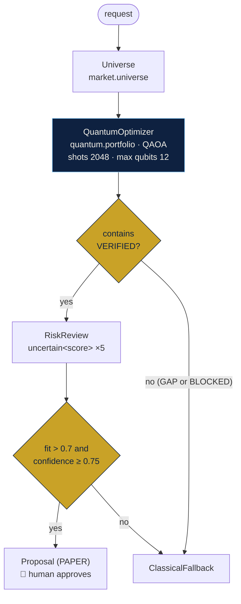

# Quantum Optimization Lab

**Sector:** Quantum computing for finance and operations · **Organisation:** AlgoProfessor Quantum Optimization Lab (an example organisation; all data is synthetic)

> **Research and decision support only. Not investment advice.** Portfolios are PAPER proposals for a named person to approve. All market and plant data is synthetic. The built-in simulator computes exactly what an ideal quantum computer would return; it runs on a classical computer and gives no quantum speed-up. Real quantum hardware is planned for v0.5.

**The problem.** Many business decisions are combinatorial: which k of n assets to hold, which jobs to put in which shift, which records to audit. Quantum algorithms such as QAOA are designed for exactly these problems, but today's quantum results are probabilistic and can be wrong. An organisation that wants to use them needs limits on what runs and proof that each answer is right, and a person has to stay accountable for the decision.

**What this AlgoLang application does**

- **Portfolio optimiser:** encodes "choose k assets, balance return against risk" as a QUBO, one qubit per asset, and solves it with QAOA (`quantum.portfolio`)
- **Every quantum answer is checked against the exact classical optimum.** The tool's first line says `VERIFIED` or `GAP`, and a deterministic guard (`if portfolio contains "VERIFIED"`) decides; no model is asked to judge
- **Qubit and shot limits in the policy:** `max qubits 12` blocks a 16-asset universe before it runs, and the org config caps every agent at 16 qubits
- Verified portfolios go to an `uncertain<score>` risk review (sampled 5 times), then a PAPER proposal for a human to approve
- **Shift scheduler:** turns the plant's job clashes into a graph and splits it into two shifts with QAOA max-cut (`quantum.maxcut`)
- **Audit sampling:** picks vouchers to audit from measured qubits (`quantum.random`), and records the draw in the audit log
- Seeded runs, so every quantum answer can be replayed and audited


## How it works: live figures
Each figure is drawn from the program itself by `tools/make_figures.py`, so it always matches the code. Moving dots show data flowing between agents; dashed blue lines are decisions; gold badges mark human gates and blue badges mark `uncertain<T>` agents that are sampled several times.

**Unpredictable audit sampling** · [`programs/audit_sampling.algo`](programs/audit_sampling.algo)

<p align="center"></p>

**Circuit lab** · [`programs/circuit_lab.algo`](programs/circuit_lab.algo)

<p align="center"></p>

**Quantum portfolio optimiser** · [`programs/portfolio_optimizer.algo`](programs/portfolio_optimizer.algo)

<p align="center"></p>

**Quantum shift scheduler** · [`programs/shift_scheduler.algo`](programs/shift_scheduler.algo)

<p align="center"></p>

## How the agents work together (`portfolio_optimizer.algo`)



## What the quantum tool returns

```
VERIFIED: the quantum answer equals the exact classical optimum
portfolio: AQB, CTS, FNP, HSF  (cost -0.489737)
classical optimum: AQB, CTS, FNP, HSF  (cost -0.489737)
QAOA p=2 on 10 qubits, 2048 shots · P(optimal)=0.0025 · approximation ratio 0.9822 · backend: simulator (exact state vector)
equal-weight expected return 14.9% · average volatility 22.4% · sectors: banking, healthcare, it, metals · risk aversion 0.5
```

`P(optimal)` is the chance that a single measurement returns the best portfolio. It is small for constrained problems at shallow depth: the optimum was found among 2,048 measurements. That is why the check matters. With the 16 mid-cap assets (when allowed), the same run returns `GAP: … 2.47% worse than the exact classical optimum`, and the flow uses the classical answer instead.

## Programs

| Program | What it does | Quantum tool |
|---|---|---|
| `portfolio_optimizer.algo` | Choose k assets for a mandate, verified, risk-reviewed, human-approved | `quantum.portfolio` (plugin, QAOA on a QUBO) |
| `shift_scheduler.algo` | Split clashing plant jobs into two shifts | `quantum.maxcut` (built in) |
| `audit_sampling.algo` | Draw an unpredictable audit sample of vouchers | `quantum.random` (built in) |
| `circuit_lab.algo` *(v0.3.3)* | Bell, GHZ and Grover circuits written as `circuit` blocks; the Grover result is checked exactly | `circuit.Bell`, `circuit.GHZ`, `circuit.Grover2` |

The other three quantum applications live with the teams that use them: quantum-safe security in [SOC Incident Command](../soc-incident-command/), Monte Carlo risk in the [Algo Trading Desk](../algo-trading-desk/) and logistics routing in the [Supply Chain Control Tower](../supply-chain-control-tower/).

## Company tools (`plugins/quantum_lab_tools.py`)

| Tool | Data |
|---|---|
| `market.universe` | `data/assets.csv`: 10 large-cap and 6 mid-cap synthetic assets with expected return and volatility |
| `quantum.portfolio` | Builds the mean-variance QUBO with a "choose exactly k" penalty and solves it with `algoquantum.solve_qubo` |
| `ops.clashes` | `data/shift_clashes.csv`: weighted clashes between plant jobs |

## Governance (`algo.config.json`)

- `"quantum": {"backend": "simulator", "max_qubits": 16, "shots": 2048, "seed": 11}`: the org-wide quantum limits; an agent's `max qubits` can only lower them
- Allowed tools are listed explicitly; protected attributes are forbidden inputs
- Calls below 0.8 confidence go to the human review queue; every call is in the hash-chained audit log
- Per-call cost cap of $0.06, run caps on cost and energy

## Run it

```bash
cd enterprise-apps/quantum-optimization-lab
algo run programs/portfolio_optimizer.algo --arg "request=Choose 4 of the large-cap assets for a balanced growth mandate, risk aversion 0.5"
algo run programs/shift_scheduler.algo --arg "site=Visakhapatnam assembly plant, Monday"
algo eval programs/portfolio_optimizer.algo        # eval blocks: verified case and blocked case
algo dev test tests                                # behaviour tests
algo batch programs/portfolio_optimizer.algo --input data/portfolio_requests.csv
```

The quantum tools need NumPy: `pip install "algolang[quantum]"` (or `pip install numpy`). To run `quantum.run` circuits on Qiskit Aer instead, set `"backend": "qiskit-aer"` and `pip install qiskit qiskit-aer`.
