# AlgoXAI Audit Studio™

**Sector:** Responsible and explainable AI · **Organisation:** AlgoXAI Audit Studio (an example organisation; all data is synthetic)

**The problem.** A credit model can be accurate and still unfair, often through a feature that quietly stands in for a protected group, such as an area index. Regulators and customers also expect every decline to be explained, and applicants to be told what they could change. Auditing that by hand is slow and inconsistent.

**What this AlgoLang application does**

- Explains one applicant's decision with **exact Shapley values**, computed over all 2⁶ feature coalitions against a background sample. The contributions add up to the prediction exactly. It also reports **global importance** (mean |SHAP|).
- Audits fairness across a protected group that is **used only for auditing, never as a model input**:
  - **disparate impact** (four-fifths rule);
  - the **equal-opportunity gap** (approval among applicants who repaid);
  - **calibration per group**;
  - a **proxy scan** for features that correlate with the group.
- Finds **actionable recourse**: the smallest change to income, existing EMI or credit utilisation that turns a decline into an approval. Age and area are never suggested changes.
- Explanation and fairness audit run **in parallel**. A biased model goes to remediation, which a person reviews. A model that passes gets an `uncertain<score>` audit opinion and then a certification that two people approve, with reasons and evidence.

## How it works: live figure

<p align="center"></p>

## What the audit finds

```
BIAS FOUND in model v1: disparate impact 0.59 < 0.8 (four-fifths rule); equal-opportunity gap 0.34 > 0.1;
                        a proxy for the protected group is a model input
proxy scan: pincode_risk (correlation 0.79 with the protected group, USED by the model)

FAIRNESS CHECKS PASSED for model v2
approval rate: group A 95.0% · group B 93.9% · disparate impact 0.99 · equal-opportunity gap 0.01

EXPLAINED model v1 for AP-10002: DECLINE (repayment probability 0.468; threshold 0.5)
  pincode_risk   0.618  -0.154     ← the proxy is the largest reason for the decline
  existing_emi  33,400  -0.153
RECOURSE for AP-10002 under model v1: existing_emi 33,400 → 30,632 → approved at 0.504
```

The same applicant is approved by model v2, which no longer uses the proxy. Removing the proxy also raised accuracy, from 72.5% to 76.8%.

## Company tools (`plugins/xai_tools.py`)

| Tool | What it computes |
|---|---|
| `xai.shapley` | Exact interventional Shapley values for one applicant; global mean \|SHAP\| |
| `fair.audit` | Approval rates, disparate impact, equal opportunity, calibration per group, proxy scan |
| `xai.counterfactual` | Minimal actionable change (in standard deviations) that flips a decline |

## Governance

Limited risk with an AI disclosure. Personal data is masked, protected attributes are withheld, audit logs are signed, and explanations must cite evidence. The eval block includes a **robustness test**: rewording the request must not change the audit's outcome.

## Run it

```bash
cd enterprise-apps/responsible-xai-studio
algo run programs/model_audit.algo --arg "request=Audit vendor credit model v1 and explain the decision for applicant AP-10002"
algo eval programs/model_audit.algo
```

Requires NumPy.
