# AlgoRL Control Room™

**Sector:** Reinforcement learning for energy systems · **Organisation:** AlgoRL Control Room (an example organisation; all data is synthetic)

**The problem.** A reinforcement-learning controller can earn more than a hand-written rule, but it learns by trial and error, and a grid cannot afford errors. Before such a policy runs, someone has to show that it is safe, that it is better than the rule it replaces, and how far it is from the best possible policy.

**What this AlgoLang application does**

- Learns when a 2 MWh campus battery should charge, idle or discharge, hour by hour, with **tabular Q-learning** over 3,000 simulated days (sunny, cloudy and heatwave), seeded and reproducible.
- Uses **safe reinforcement learning**: a safety shield removes actions that would break the 1.75 MW grid-import cap, and cap breaches are penalised during learning.
- Measures the learned policy against the **exact optimum** computed by finite-horizon value iteration, a time-of-day rule and doing nothing, on the same 1,000 simulated days. Then it **stress-tests** all of them on 1,000 heatwave days. Evaluation and stress test run in parallel.
- Counts only **avoidable** cap violations: hours when a safe action existed. Hours when the load alone exceeds the cap plus full battery power are reported separately.
- A deterministic guard enforces the grid code: **a policy trained without the shield is never deployed**, even if it looks safe in simulation.
- A policy that beats the rule goes to an `uncertain<score>` operations-risk review, then a deployment that two different engineers approve. An under-trained policy keeps the rule in service.

## How it works: live figure

<p align="center"></p>

## What the tools return

```
SAFE AND BEATS BASELINE: learned policy earns ₹4,514/day more than the time-of-day rule, no cap violations
  learned (Q-learning)             ₹    7,558/day vs doing nothing · 0 avoidable cap violations  (7% of the optimum's gain missed)
  exact optimum (value iteration)  ₹    8,108/day vs doing nothing · 0 avoidable cap violations
  time-of-day rule                 ₹    3,043/day vs doing nothing · 0 avoidable cap violations  (62% of the optimum's gain missed)
  do nothing                       ₹        0/day vs doing nothing · 123 avoidable cap violations
```

With only 50 days of training, the same pipeline reports `SAFE BUT WEAKER` and keeps the rule.

## Company tools (`plugins/rl_tools.py`)

| Tool | What it computes |
|---|---|
| `rl.train` | Q-learning over 24 hours × 11 charge levels × 3 actions, with or without the safety shield; learning curve |
| `rl.evaluate` | The learned policy, the value-iteration optimum and two baselines on 1,000 simulated days |
| `rl.stress` | The same on 1,000 heatwave days (35% more load, 60% higher prices) |

`data/microgrid.json` holds the battery, prices, load profile and day types.

## Run it

```bash
cd enterprise-apps/rl-control-room
algo run programs/dispatch_policy.algo --arg "request=Learn a battery dispatch policy for the campus microgrid with the safety shield on"
algo eval programs/dispatch_policy.algo
```

Requires NumPy.
