# AlgoCity Operations Centre™

**Sector:** Smart cities · **Organisation:** an example municipal corporation with 60 air-quality stations, 400 smart bins and a 60 MW distribution feeder (all data is synthetic)

**The problem.** A city control room receives air, waste and electricity data around the clock, but each arrives on a separate screen. Smog advisories go out late, trucks drive fixed routes past half-empty bins, and feeder overloads are found when the lights go out. Public actions such as health advisories and load shedding must still be decided by accountable officers.

**What this AlgoLang application does**

- Checks three city systems **in parallel**:
  - **Air quality:** India's **National AQI** using the CPCB method. Each pollutant gets a sub-index by linear interpolation within the official breakpoints, and the AQI is the worst sub-index. Results are given per station and per zone.
  - **Waste collection:** collects only bins that are **75% full or more**. Bins are swept into truck loads, then each route is built by **nearest neighbour from the depot and improved with 2-opt**. The distance is compared with the fixed route through every bin.
  - **Electricity:** forecasts tomorrow's feeder load from a **weekly-hour seasonal profile plus an exponentially smoothed level**. The forecast is back-tested on the last 7 days (MAPE) and the peak is checked against the 60 MW limit.
- **AQI very poor or severe** → a multilingual public health advisory, which the **duty officer approves** before it is published. The advisory carries an AI disclosure.
- **Overload risk** → a load-management plan (demand response, load transfer, and rotational shedding only as a last resort, never hospitals, water pumping or signals), which **two officers approve**.
- Otherwise → the daily operations brief.
- A **live sensor stream** (AlgoPulse™ bus `city`, topic `air.readings`) scores every reading as it arrives. Duplicate readings are removed, and very poor or severe readings are escalated to `air.alerts` for a person to verify.

## How it works: live figure

<p align="center"></p>

## What the tools return

```
AQI SEVERE at worst (465 at AQ-49, Charminar; driven by PM10) on the post-diwali day
AQI VERY POOR at worst (303 at AQ-24, Mehdipatnam; driven by PM2.5) on the winter-weekday day
60 stations: moderately polluted 36, poor 18, very poor 6

ROUTES 1 truck(s) for 57 of 400 bins at 75%+ full · 102.8 km vs 249.0 km for the fixed route through every bin (−59%)

WITHIN LIMIT: tomorrow's peak 48.9 MW at 18:00 (limit 60 MW) · normal weeks · back-test MAPE 2.9%
OVERLOAD RISK: tomorrow's peak 58.9 MW at 19:00 is above the 60 MW feeder limit · heatwave weeks · back-test MAPE 6.1%

AQI VERY POOR 316 at AQ-12 (driven by PM2.5) · sub-indices: PM2.5 316, PM10 180, NO2 75
```

## Company tools (`plugins/city_tools.py`)

| Tool | Method |
|---|---|
| `city.aqi` | CPCB National AQI: breakpoint interpolation, worst sub-index, zone summary |
| `city.waste` | Fill-level threshold, angular sweep into truck loads, nearest neighbour + 2-opt |
| `city.energy` | Weekly-hour seasonal profile, exponential smoothing, 7-day back-test (MAPE), limit check |
| `city.reading` | AQI of one live sensor reading (needs three pollutants, one of them PM2.5 or PM10) |

Pure Python; no extra packages.

## Run it

```bash
cd enterprise-apps/smart-city-operations
algo run programs/city_operations.algo --arg "situation=post-Diwali morning, normal load"
algo run programs/city_operations.algo --flow sensor --arg "reading=AQ-12 PM2.5 140 PM10 220 NO2 60"
algo stream programs/city_operations.algo --input data/air_events.jsonl
algo batch programs/city_operations.algo --input data/situations.csv
```
