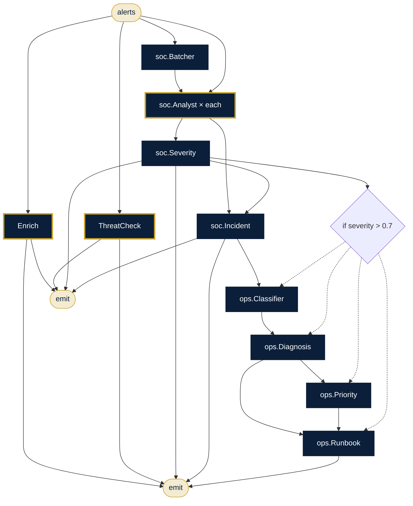

# SOC Incident Command

**Sector:** Cybersecurity & IT operations · **Organisation:** Helix Cloud Services (an example organisation; all data is synthetic)

**The problem.** Security operations centres drown in alerts. Analysts need assets, owners and threat intelligence in seconds, a severity call, and, for serious incidents, an IT runbook straight away.

**What this AlgoLang application does**

- Enriches alerts with the CMDB (asset tier, owner, dependencies) and checks every IP and domain against threat intel, in parallel
- Splits the alert batch, analyses each part in parallel and scores severity
- Severe → hands the incident to IT operations for classification, diagnosis, priority and a first-response runbook
- A phishing desk checks forwarded emails against the blocklist and advises staff and the SOC

## How the agents work together (`alert_to_incident.algo`)



## Programs

| Program | Input | Flow |
|---|---|---|
| `programs/alert_to_incident.algo` | `alerts` | Enrich ∥ threat intel → batch → analysts (parallel) → severity → incident → runbook |
| `programs/phishing_desk.algo` | `email` | Link check → indicators → assessment → likelihood → advice |

## Company tools (`plugins/`)

Agents can call a tool only if the program declares it, the agent lists it under `uses`, and `algo.config.json` allows it.

| Tool | What it does |
|---|---|
| `cmdb.lookup` | Configuration management database (data/cmdb.csv) |
| `ioc.check` | Indicator-of-compromise blocklist (data/iocs.csv) |
| `kb.search` | Runbooks (kb/runbooks.md) |

## Governance (`algo.config.json`)

| Rule | Setting |
|---|---|
| Forbidden inputs (checked when the program compiles and again when it runs) | gender, caste, religion |
| Human review below confidence | 0.8 (each agent's own threshold applies if it is stricter) |
| Max token budget per agent | 8,000 |
| Max tokens per run | 100,000 |
| Allowed tools | `kb.search`, `cmdb.lookup`, `ioc.check` |
| Audit | SHA-256 hash-chained log in `runs/`, checked with `algo audit verify` |

## Run it

Run these from this folder, so `algo.config.json` and the plugins load.

```bash
algo run programs/alert_to_incident.algo --arg "alerts=auth-api: 4,200 failed logins in 5 minutes from 185.220.101.7; payments-gw latency up 300%"
algo batch programs/alert_to_incident.algo --input data/alerts.csv --workers 8      # every row, in parallel
algo review                     # approve or reject what was sent to a human
algo audit verify               # prove the audit log was not edited
algo report                     # usage, escalations and confidence per program
algo dev test tests             # 3 behaviour tests (offline, deterministic)
algo studio                     # open it in the graphical Studio
```

Add `--live` and set `ANTHROPIC_API_KEY` to use real Claude models instead of the offline agents.
