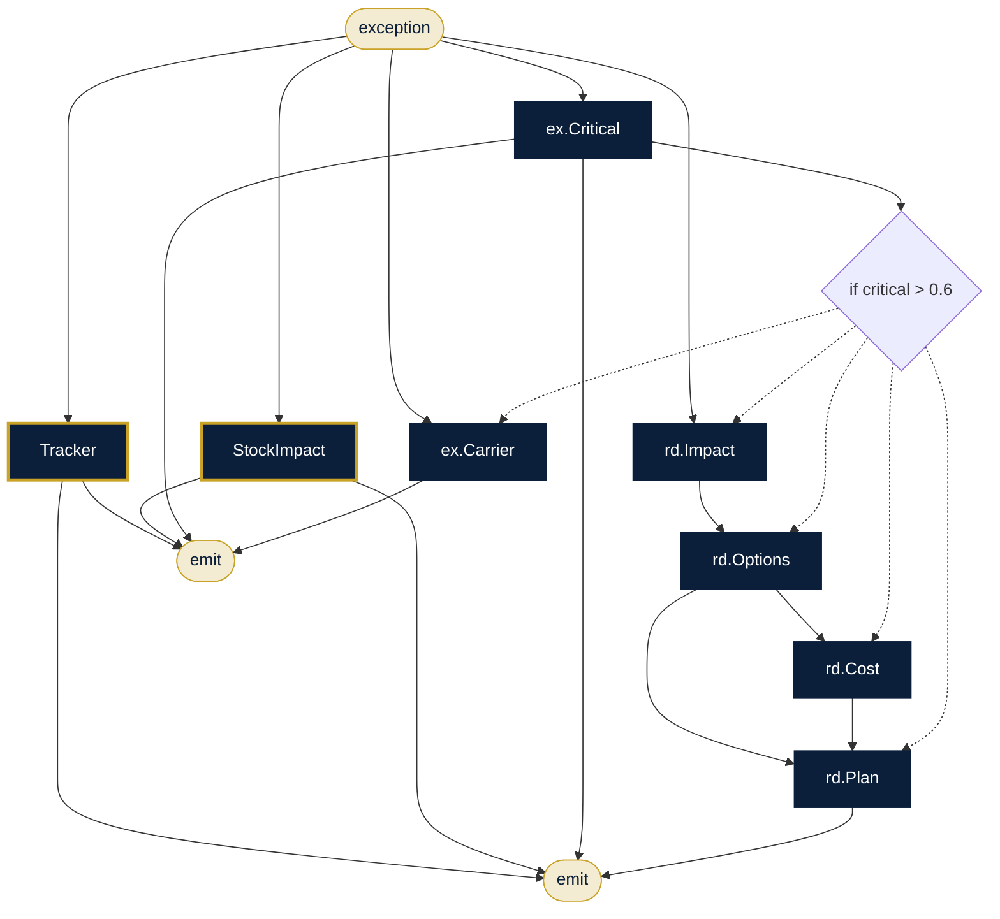

# Supply Chain Control Tower

**Sector:** Logistics & retail · **Organisation:** Konark Retail Logistics (an example organisation; all data is synthetic)

**The problem.** Shipment exceptions such as customs holds, breakdowns and damage need a quick view of where the goods are and how much stock is left, then a recovery plan before shelves go empty.

**What this AlgoLang application does**

- Tracks the shipment and checks stock cover for the affected SKUs, in parallel
- Scores how critical the exception is
- Critical → assesses the impact, proposes alternatives, scores their cost and writes a recovery plan
- Otherwise → drafts the carrier follow-up

## How the agents work together (`exception_desk.algo`)



## Programs

| Program | Input | Flow |
|---|---|---|
| `programs/exception_desk.algo` | `exception` | Track ∥ stock → critical? → impact, options, cost, plan; or carrier note |

## Company tools (`plugins/`)

Agents can call a tool only if the program declares it, the agent lists it under `uses`, and `algo.config.json` allows it.

| Tool | What it does |
|---|---|
| `shipment.track` | Shipment status and ETA (data/shipments.csv) |
| `inventory.levels` | Stock on hand and days of cover (data/inventory.csv) |

## Governance (`algo.config.json`)

| Rule | Setting |
|---|---|
| Forbidden inputs (checked when the program compiles and again when it runs) | gender, caste, religion |
| Human review below confidence | 0.7 (each agent's own threshold applies if it is stricter) |
| Max token budget per agent | 8,000 |
| Max tokens per run | 80,000 |
| Allowed tools | `kb.search`, `inventory.levels`, `shipment.track` |
| Audit | SHA-256 hash-chained log in `runs/`, checked with `algo audit verify` |

## Run it

Run these from this folder, so `algo.config.json` and the plugins load.

```bash
algo run programs/exception_desk.algo --arg "exception=SHP-50011 held at Chennai customs: invoice value mismatch; SKU-3307 has 2 days of cover"
algo batch programs/exception_desk.algo --input data/exceptions.csv --workers 8      # every row, in parallel
algo review                     # approve or reject what was sent to a human
algo audit verify               # prove the audit log was not edited
algo report                     # usage, escalations and confidence per program
algo dev test tests             # 1 behaviour tests (offline, deterministic)
algo studio                     # open it in the graphical Studio
```

Add `--live` and set `ANTHROPIC_API_KEY` to use real Claude models instead of the offline agents.
