# AlgoMove Transport Network Optimizer™

**Sector:** Transportation systems · **Organisation:** an example city transport authority with 1,600 junctions, 576 traffic signals, 48 zones and 12 bus routes (all data is synthetic)

**The problem.** When an arterial road closes, traffic floods the side streets within minutes. Fixed signal plans cannot absorb the extra traffic, and nobody knows which junctions will lock up first. Bus services are planned once a year, so a metro disruption or festival crowd leaves passengers stranded.

**What this AlgoLang application does**

- For a road **incident**, it works out two things **in parallel**:
  - **the fastest detour**: **Dijkstra's algorithm** on 1,600 junctions and 6,240 directed links, with congested travel times, before and after the closed links are removed;
  - **signal retiming on the detour** by **Webster's method**, after the diverted traffic is added: flow ratios y = q/s, optimal cycle C0 = (1.5L + 5)/(1 − Y), green splits and uniform delay.
- **Oversaturated junctions** (Y ≥ 0.9, where no timing can cope) → a police control, turn-ban and metering plan that the **control-room officer approves**.
- Otherwise → retimed signals and a public diversion notice that carries an AI disclosure.
- Retiming all 576 signals with Webster's method cuts the average delay from 23.5 to **10.0 s per vehicle** compared with a fixed 120 s plan.
- A **planning flow** estimates morning-peak travel demand with a **doubly constrained gravity model, balanced by Furness iteration** (869,141 trips between 48 zones). From the peak-direction load it sets each bus route's headway and the buses needed.
  - A **fleet shortfall** (for example during a metro disruption, +35% demand) needs **two approvals** before extra buses are hired.

## How it works: live figure

<p align="center"></p>

## What the tools return

```
MAJOR DELAY: INC-01 overturned truck on Ring Road R20 between C15 and C25 adds 6.5 min (25.5 → 32.0 min) · 1,800 vehicles/h diverted
OVERSATURATED 39 of 40 detour junctions even with optimal timing (Y >= 0.9)

MINOR DELAY: INC-02 water-main repair on a local street near N1312 adds 0.7 min (8.1 → 8.8 min) · 180 vehicles/h diverted
DETOUR SIGNALS RETIMED 9 junctions within capacity

SIGNALS RETIMED 576 of 576 junctions · average delay 10.0 s/veh vs 23.5 s with the fixed 120 s plan (−58%)
DEMAND 869,141 morning-peak trips between 48 zones · mean trip 15.5 min · Furness balanced in 7 iterations
SERVICE FEASIBLE: 282 of 320 buses at peak
FLEET SHORTFALL: the routes need 364 buses at peak, the depot has 320 (44 short) · SURGE +35%
```

## Company tools (`plugins/transport_tools.py`)

| Tool | Method |
|---|---|
| `traffic.reroute` | Dijkstra (binary heap) before and after link closures |
| `signal.retime` | Webster optimal cycle, green splits, uniform delay; oversaturation check |
| `demand.od` | Doubly constrained gravity model, exponential deterrence, Furness balancing |
| `transit.headway` | Peak-direction route load, headway at 85% of capacity, fleet requirement |

Pure Python; no extra packages.

## Run it

```bash
cd enterprise-apps/transport-network-optimizer
algo run programs/network_operations.algo --arg "incident=INC-01 reported by control room camera"
algo run programs/network_operations.algo --flow plan --arg "request=metro disruption on Line 2, weekday peak"
algo batch programs/network_operations.algo --input data/incidents.csv
```
