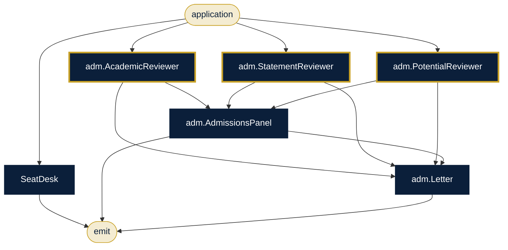

# University Admissions & OBE

**Sector:** Higher education · **Organisation:** Deccan Institute of Technology (an example organisation; all data is synthetic)

**The problem.** Admissions must be merit-based and fair, and every course needs NBA/NAAC outcome-based-education (OBE) evidence: CO-PO mapping and Bloom-balanced question papers.

**What this AlgoLang application does**

- Checks seats and merit cut-offs for the programme applied to
- Academic, statement and potential reviewers assess each application independently and in parallel
- An admissions panel scores the case and drafts the letter. Caste, gender, religion, nationality and income are forbidden inputs
- For accreditation: maps every course outcome to programme outcomes, scores alignment and builds the CO-PO matrix
- Writes questions for every unit at several Bloom levels, checks coverage and assembles the paper

## How the agents work together (`admissions.algo`)



## Programs

| Program | Input | Flow |
|---|---|---|
| `programs/admissions.algo` | `application` | Seat matrix + three reviewers in parallel → panel → letter |
| `programs/obe_course_file.algo` | `course` | OBE rules → COs → CO-PO mapping (parallel) → matrix; units → questions (parallel) → paper |

## Company tools (`plugins/`)

Agents can call a tool only if the program declares it, the agent lists it under `uses`, and `algo.config.json` allows it.

| Tool | What it does |
|---|---|
| `seats.lookup` | Seat matrix and cut-offs (data/seat_matrix.csv) |
| `kb.search` | OBE guide (kb/obe_guide.md) |

## Governance (`algo.config.json`)

| Rule | Setting |
|---|---|
| Forbidden inputs (checked when the program compiles and again when it runs) | gender, caste, religion, nationality, income |
| Human review below confidence | 0.75 (each agent's own threshold applies if it is stricter) |
| Max token budget per agent | 8,000 |
| Max tokens per run | 80,000 |
| Allowed tools | `kb.search`, `file.read`, `seats.lookup` |
| Audit | SHA-256 hash-chained log in `runs/`, checked with `algo audit verify` |

## Run it

Run these from this folder, so `algo.config.json` and the plugins load.

```bash
algo run programs/admissions.algo --arg "application=Applicant AD-901 for B.Tech AI & Data Science: 12th PCM 91%, JEE percentile 93, built a crop-disease app"
algo batch programs/admissions.algo --input data/applications.csv --workers 8      # every row, in parallel
algo review                     # approve or reject what was sent to a human
algo audit verify               # prove the audit log was not edited
algo report                     # usage, escalations and confidence per program
algo dev test tests             # 2 behaviour tests (offline, deterministic)
algo studio                     # open it in the graphical Studio
```

Add `--live` and set `ANTHROPIC_API_KEY` to use real Claude models instead of the offline agents.
