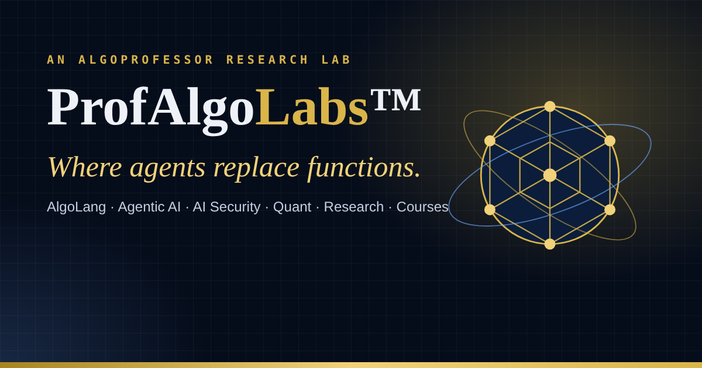

# ProfAlgoLabs™ website

The website of **ProfAlgoLabs™**, the research lab of AlgoProfessor AI R&D Solutions and home of AlgoLang.
Live address: **https://www.profagentlabs.algoprofessor.com**

| Folder | What it is |
|---|---|
| `public_html/` | Ready to upload to cPanel: the 3D page, contact form, visitor counter, security headers, SEO files and icons |
| `source/` | The editable page (`profalgolabs.html`) and `build_deploy.py`, which rebuilds `public_html/` |
| `DEPLOY_GUIDE.txt` | Step-by-step cPanel deployment |

**What the page includes**
- A Three.js 3D scene behind the whole page, with a reduced-motion version and a fallback when WebGL isn't available
- About the Lab (inspired by Bell Labs), six research divisions, the lab timeline and the lab director
- The 10 AlgoProfessor services, including the new Programming Language & Compiler Development service
- An AlgoLang showcase with a lab console that walks through an agent run
- A live visitor counter (`counter.php`). It ignores bots and stores no IP addresses.
- A contact form (`contact.php`) that emails ceo@algoprofessor.com. It is protected by a same-site check, a one-time token, a time trap, a hidden honeypot field, rate limiting and input validation.
- Security headers: HTTPS-only (HSTS), a strict Content-Security-Policy with script hashes, and blocking of framing and private files
- SEO: meta and Open Graph tags, schema.org data (organisation, services, founder, software), a sitemap, robots.txt and a web manifest

**After editing the page:** run `cd lab-website/source && mkdir -p deploy/data deploy/assets && python3 build_deploy.py`, then copy `deploy/index.html` and `deploy/.htaccess` into `public_html/`. This refreshes the CSP script hashes, which every change to an inline script needs.
